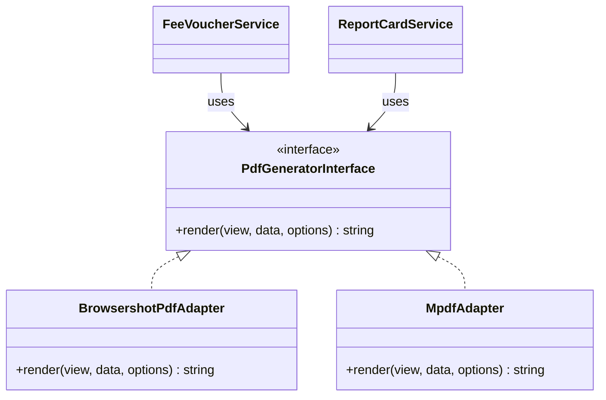

# EduCore SaaS — Architecture Specification v2.1 (Final Corrections)
**Document Version:** 2.1.0  
**Date:** November 2026  
**Status:** Architecture Specification — Final Refinement  

---

## 1. Updated Technology Stack & Package Compatibility Matrix

### 1.1 Laravel 13 Primary Framework Baseline
* **Framework:** **Laravel 13.x** is adopted as the primary framework baseline.
  * *Release Schedule Context:* Laravel adheres to an annual major release cycle (Laravel 11 in early 2024, Laravel 12 in early 2025, Laravel 13 in early 2026). Laravel does not use arbitrary "LTS" designations; every major release receives 18 months of bug fixes and 2 years of security updates.
  * *Runtime:* **PHP 8.3+** (specifically PHP 8.3.15+ or PHP 8.4.2, both present in the host environment).
* **Frontend Reactivity & Styling:**
  * **Livewire 3.5+ / Livewire 4:** Livewire is fully supported on Laravel 13. Livewire 4 provides unified Alpine reactivity and streaming attributes. The component layer will adhere strictly to standard Livewire syntax, avoiding legacy Livewire 2/early v3 workarounds.
  * **Tailwind CSS v4.0:** Utilizes the new CSS-first `@theme` configuration with Vite, utilizing native CSS logical properties (`margin-inline-start`, `padding-inline-end`, `border-inline-start`) for seamless bilingual LTR/RTL rendering.
* **Database:** **PostgreSQL 15.15+** (host environment has 15.15 installed; completely forward-compatible with PostgreSQL 16 and 17).

### 1.2 Package Compatibility & Fallback Trade-Off Analysis

| Package | Evaluated Version | Laravel 13 Compatibility | Trade-Off & Mitigation Strategy |
| :--- | :--- | :--- | :--- |
| **`laravel/sanctum`** | `^4.0` | **Full First-Party Support** | Zero friction. Native first-party authentication for SPA, mobile, and API. |
| **`spatie/laravel-permission`** | `^6.0` | **Compatible** | Requires configuring `teams => true` and mapping `team_foreign_key => 'tenant_id'` to ensure permissions are strictly tenant-isolated. |
| **`stancl/tenancy`** | `^3.8` / `^4.0` | **Evaluated Alternative** | While feature-rich, full-package multi-tenant libraries often lag major Laravel releases by several months and introduce opinionated database/cache hooks. **Decision:** We implement a lightweight, native Laravel 13 multi-tenant kernel (TenantContext + Eloquent Global Scopes + PostgreSQL RLS) using first-party contracts, eliminating third-party framework lock-in. |
| **`barryvdh/laravel-dompdf`** | `^3.0` | **Compatible** | Pure PHP, but lacks bidirectional Arabic/Urdu text shaping algorithms and modern CSS flexbox/grid. Retained strictly for simple English reports. |
| **`mpdf/mpdf`** | `^8.2` | **Compatible** | Pure PHP with native UTF-8 RTL script shaping (HarfBuzz-like logic). Evaluated in PoC. |
| **`spatie/browsershot`** | `^4.0` | **Compatible** | Requires Node.js and headless Chromium on host. Evaluated in PoC. |

---

## 2. PostgreSQL RLS — Hardened Security & Isolation Engine

### 2.1 Corrected PostgreSQL RLS Policy Semantics
> [!IMPORTANT]
> **PostgreSQL Policy Evaluation Rules:**
> PostgreSQL evaluates policies using Boolean logic:  
> `(Permissive Policy 1 OR Permissive Policy 2 ...) AND (Restrictive Policy 1 AND Restrictive Policy 2 ...)`  
> If an application defines **only** a `RESTRICTIVE` policy without an active `PERMISSIVE` policy, PostgreSQL defaults to denying access entirely.

The corrected standard implementation utilizes an explicit **Permissive Policy** tied to the unprivileged application role `educore_app`, backed by `FORCE ROW LEVEL SECURITY`:

```sql
-- 1. Ensure table enforces RLS even on the table owner
ALTER TABLE students ENABLE ROW LEVEL SECURITY;
ALTER TABLE students FORCE ROW LEVEL SECURITY;

-- 2. Drop legacy or draft policies
DROP POLICY IF EXISTS tenant_isolation_permissive ON students;

-- 3. Define Standard PERMISSIVE policy with parameter-safe session lookup
CREATE POLICY tenant_isolation_permissive ON students
    FOR ALL
    TO educore_app
    USING (
        tenant_id = NULLIF(current_setting('app.current_tenant_id', true), '')::uuid
    )
    WITH CHECK (
        tenant_id = NULLIF(current_setting('app.current_tenant_id', true), '')::uuid
    );
```

### 2.2 Parameter-Safe `set_config` Execution
Standard `SET LOCAL app.current_tenant_id = ?` statements are not valid parameterized SQL in PDO and many PostgreSQL drivers.

**Corrected Implementation:** Use `set_config(name, value, is_local)`:
```php
namespace App\Core\Tenancy;

use Illuminate\Support\Facades\DB;

class PostgresTenantContext
{
    /**
     * Sets the tenant context safely within the current database transaction.
     * is_local = true ensures the setting automatically reverts on COMMIT or ROLLBACK.
     */
    public static function set(string $tenantId): void
    {
        DB::statement("SELECT set_config('app.current_tenant_id', ?, true)", [$tenantId]);
    }

    /**
     * Resets the tenant context to empty/null.
     */
    public static function reset(): void
    {
        DB::statement("SELECT set_config('app.current_tenant_id', '', true)");
    }
}
```

### 2.3 Composite Tenant-Aware Constraints (Foreign Key Defense-in-Depth)
To physically prevent cross-tenant record injection at the database constraint level (e.g. assigning a Student from Tenant A to a Section belonging to Tenant B), all relationships across tenant-owned entities enforce **Composite Foreign Keys** including `tenant_id`:

```sql
-- 1. Academic Sections composite key
ALTER TABLE school_sections 
    ADD CONSTRAINT uk_sections_tenant_id 
    UNIQUE (tenant_id, id);

-- 2. Student Enrollments enforcing composite tenant constraint
ALTER TABLE school_student_enrollments
    ADD CONSTRAINT fk_enrollment_section_tenant
    FOREIGN KEY (tenant_id, school_section_id)
    REFERENCES school_sections(tenant_id, id)
    ON DELETE RESTRICT;

-- 3. Chart of Accounts composite key
ALTER TABLE chart_of_accounts 
    ADD CONSTRAINT uk_accounts_tenant_id 
    UNIQUE (tenant_id, id);

-- 4. Journal Entry Lines enforcing composite tenant constraint
ALTER TABLE journal_entry_lines
    ADD CONSTRAINT fk_journal_lines_account_tenant
    FOREIGN KEY (tenant_id, account_id)
    REFERENCES chart_of_accounts(tenant_id, id)
    ON DELETE RESTRICT;
```
*Result:* Even if an application bug attempts to associate Section B (`tenant_id = 'tenant-2'`) with an enrollment for Tenant 1 (`tenant_id = 'tenant-1'`), the PostgreSQL foreign key engine immediately aborts the query with a foreign key violation.

### 2.4 End-to-End Execution Vector Isolation

| Execution Vector | Isolation Mechanism | Failure Mode Handling |
| :--- | :--- | :--- |
| **HTTP Requests** | `IdentifyTenantBySubdomain` middleware sets `TenantContext` and executes `PostgresTenantContext::set($tenant->id)` within request database transactions. | If subdomain is invalid or inactive, request terminates immediately with `404/403` before database queries execute. |
| **Incoming Webhooks** | Webhook payload/header extracts `tenant_id` or unique token; passes through `VerifyWebhookSignature` middleware to load tenant. | If signature or tenant lookup fails, returns `401 Unauthorized` without database mutation. |
| **Background Jobs** | Every job implements `TenantAwareJob` carrying `public string $tenantId`. Intercepted by `TenantQueueMiddleware`. | Context is established inside the job's transaction and safely cleared in a `finally` block (see section 2.5). |
| **Data Exports** | Streaming exporters (`OpenSpout`) query through Eloquent models with active Global Tenant Scopes and RLS. | Export process inherits running tenant context. Output written directly to private tenant storage. |
| **Application Cache** | Cache keys formatted as `tenants:{tenant_id}:{module}:{key}`. Tagged cache operations use `tenant:{tenant_id}`. | Cross-tenant cache keys cannot collide. Tenant deletion flushes only its specific tag. |
| **File Storage** | Storage root partitioned: `storage/app/tenants/{tenant_id}/{module}/{file_uuid}`. | Controller validates `tenant_id` ownership before generating temporary signed binary stream. |
| **Scheduled Tasks** | Scheduled console commands run either in a maintenance scope or iterate through active tenants explicitly via `Tenant::chunk()`, isolating each iteration. | Each tenant iteration runs inside its own isolated context and transaction. A failure in Tenant A does not stop Tenant B. |

### 2.5 Robust Queue Worker Middleware
```php
namespace App\Core\Tenancy\Middleware;

use App\Core\Tenancy\PostgresTenantContext;
use App\Core\Tenancy\TenantContext;
use App\Modules\Institute\Models\Tenant;
use Illuminate\Support\Facades\DB;

class TenantQueueMiddleware
{
    public function handle(object $job, callable $next): mixed
    {
        if (!isset($job->tenantId)) {
            return $next($job);
        }

        $tenant = Tenant::query()->where('status', 'active')->findOrFail($job->tenantId);

        // Bind application context singleton
        app(TenantContext::class)->setTenant($tenant);

        // Execute job within a transaction-safe tenant context
        return DB::transaction(function () use ($tenant, $job, $next) {
            PostgresTenantContext::set($tenant->id);

            try {
                return $next($job);
            } finally {
                PostgresTenantContext::reset();
                app(TenantContext::class)->clear();
            }
        });
    }
}
```

### 2.6 Cross-Tenant Security Test Suite Specification
The automated test suite (`tests/Feature/Security/CrossTenantIsolationTest.php`) executes before every pipeline merge:
1. **Connection Reuse Leak Test:** Connect as Tenant A, perform queries, return connection to pool, run query without context, verify 0 rows returned.
2. **Missing Tenant Context Test:** Execute query when `app.current_tenant_id` is unset or null; verify query returns zero rows (not all rows).
3. **Cross-Tenant Insert Test:** Authenticate as Tenant A, attempt to insert row with `tenant_id = 'tenant-b'`; verify transaction aborts via RLS `WITH CHECK` violation.
4. **Cross-Tenant Relationship Injection Test:** Attempt to link a Tenant A student enrollment to a Tenant B section; verify PostgreSQL composite foreign key constraint throws violation.
5. **Direct Signed URL Tampering Test:** Generate signed file download URL under Tenant A; attempt download using Tenant B session; verify `403 Forbidden` response.

---

## 3. Double-Entry General Ledger — Database-Level Integrity

### 3.1 Database-Enforced Balance Constraint ($\sum \text{Debits} = \sum \text{Credits}$)
To guarantee financial integrity regardless of application layer bugs, balancing is verified at the database level when posting.

```sql
-- Function to validate balanced entries upon posting
CREATE OR REPLACE FUNCTION verify_journal_entry_balanced()
RETURNS TRIGGER AS $$
DECLARE
    v_total_debit NUMERIC(14, 2);
    v_total_credit NUMERIC(14, 2);
    v_line_count INT;
BEGIN
    -- Only execute when status transitions to 'posted'
    IF NEW.status = 'posted' AND (OLD.status IS DISTINCT FROM 'posted') THEN
        
        SELECT 
            COALESCE(SUM(CASE WHEN entry_type = 'debit' THEN amount ELSE 0 END), 0),
            COALESCE(SUM(CASE WHEN entry_type = 'credit' THEN amount ELSE 0 END), 0),
            COUNT(*)
        INTO v_total_debit, v_total_credit, v_line_count
        FROM journal_entry_lines
        WHERE journal_entry_id = NEW.id;

        IF v_line_count < 2 THEN
            RAISE EXCEPTION 'Posted journal entry % must contain at least two lines.', NEW.entry_number;
        END IF;

        IF v_total_debit <> v_total_credit THEN
            RAISE EXCEPTION 'Journal entry % is unbalanced: Total Debits (%) do not equal Total Credits (%).', 
                NEW.entry_number, v_total_debit, v_total_credit;
        END IF;

        NEW.posted_at = NOW();
    END IF;

    RETURN NEW;
END;
$$ LANGUAGE plpgsql;

CREATE TRIGGER trg_verify_journal_entry_balanced
    BEFORE UPDATE ON journal_entries
    FOR EACH ROW
    EXECUTE FUNCTION verify_journal_entry_balanced();
```

### 3.2 Immutability Triggers (Preventing Modification or Deletion of Posted Records)
```sql
-- 1. Prevent modification or deletion of posted journal headers
CREATE OR REPLACE FUNCTION prevent_posted_journal_mutation()
RETURNS TRIGGER AS $$
BEGIN
    IF OLD.status = 'posted' THEN
        -- Allow updating only reversed_by_entry_id or status to 'reversed'
        IF TG_OP = 'UPDATE' AND NEW.status = 'reversed' AND OLD.reversed_by_entry_id IS NULL THEN
            RETURN NEW;
        END IF;
        
        RAISE EXCEPTION 'Cannot modify or delete posted journal entry %.', OLD.entry_number;
    END IF;
    RETURN OLD;
END;
$$ LANGUAGE plpgsql;

CREATE TRIGGER trg_prevent_posted_journal_mutation
    BEFORE UPDATE OR DELETE ON journal_entries
    FOR EACH ROW
    EXECUTE FUNCTION prevent_posted_journal_mutation();

-- 2. Prevent mutation or deletion of lines belonging to posted entries
CREATE OR REPLACE FUNCTION prevent_posted_journal_line_mutation()
RETURNS TRIGGER AS $$
DECLARE
    v_parent_status VARCHAR(20);
BEGIN
    SELECT status INTO v_parent_status FROM journal_entries WHERE id = OLD.journal_entry_id;
    
    IF v_parent_status = 'posted' THEN
        RAISE EXCEPTION 'Cannot modify or delete lines of a posted journal entry.';
    END IF;
    RETURN OLD;
END;
$$ LANGUAGE plpgsql;

CREATE TRIGGER trg_prevent_posted_journal_line_mutation
    BEFORE UPDATE OR DELETE ON journal_entry_lines
    FOR EACH ROW
    EXECUTE FUNCTION prevent_posted_journal_line_mutation();
```

### 3.3 Deletion Cascades Removal & Tenant Consistency
* **Removed:** `ON DELETE CASCADE` is explicitly prohibited on `journal_entry_lines`.
* **Applied:** `ON DELETE RESTRICT` is enforced. A journal entry cannot be deleted while child lines exist. Once posted, the triggers above block deletion of both header and lines entirely.
* **Tenant Consistency:** `journal_entry_lines` includes `tenant_id` and is constrained by `FOREIGN KEY (tenant_id, journal_entry_id) REFERENCES journal_entries(tenant_id, id) ON DELETE RESTRICT`.

### 3.4 Reversals, Refunds, and Corrections Workflow
1. **Reversal of Erroneous Invoice/Entry:**
   * Posted entry is **never deleted or edited**.
   * System generates a compensating **Reversal Journal Entry** (`status = 'posted'`, `source_type = 'reversal'`, referencing `source_id = original_entry.id`).
   * Lines are mirrored: Original Debits become Credits; Original Credits become Debits.
   * Original entry has its `status` updated to `'reversed'` and `reversed_by_entry_id` set to the new entry's UUID.
2. **Refund Workflow (Fee Returned to Parent):**
   * Produces a **Refund Transaction** linked to a formal Credit Note.
   * Journal Entry:
     ```
     Debit:  4010 Tuition Fee Revenue (or 2010 Unearned Revenue)    PKR 5,000
     Credit: 1010 Cash on Hand (or 1020 Bank Account)              PKR 5,000
     ```
   * Cashier shift balance reflects the cash payout; voucher status updates to `refunded`.

---

## 4. PDF Generation Architecture: Adapter Pattern & PoC Matrix

### 4.1 Architecture: Decoupled PDF Adapter Pattern
To avoid hardcoding rendering assumptions into billing and academic modules, all document generation is encapsulated behind a strict interface:

```php
namespace App\Core\Document;

interface PdfGeneratorInterface
{
    /**
     * Renders a view into a raw PDF binary string.
     * 
     * @param string $view Blade view template name
     * @param array $data Data payload passed to view
     * @param array $options Options (orientation, paper_size, margins)
     * @return string Raw PDF binary string
     */
    public function render(string $view, array $data, array $options = []): string;
}
```

Modules inject `PdfGeneratorInterface`. The active adapter is bound in the service container via `config('services.pdf.driver')`.



### 4.2 Proof-of-Concept (PoC) Specification: Realistic Bilingual 3-Part Challan
Before standardizing the production driver, a targeted PoC will be executed using a standardized test voucher containing:
1. **3 Columns (Bank Copy, Institute Copy, Student Copy)** on a single landscape A4 sheet.
2. **Bilingual Typography:** English headings (`Tuition Fee`, `Due Date`) alongside Urdu text with complex ligatures (`فیس واؤچر`, `طالب علم کا نام`, `داخلہ نمبر`).
3. **Barcodes/QR Codes:** 2D QR code for mobile scanning and 1D Code128 barcode for bank cashier scanning.
4. **Tabular Numbers & Grid Lines:** Numeric fee breakdown aligned cleanly.

### 4.3 Evaluation Matrix & Acceptance Criteria

| Evaluation Dimension | Browsershot Adapter (Chromium) | mPDF Adapter (PHP Native) | PoC Acceptance Threshold |
| :--- | :--- | :--- | :--- |
| **Urdu Font Shaping & Ligatures** | Native browser layout engine (Blink) provides pixel-perfect Naskh & Nastaliq rendering. | Built-in font shaping logic; handles Naskh well, but requires fine-tuned OTF tables for Nastaliq. | Zero overlapping characters, broken ligatures, or reversed character ordering. |
| **RTL & CSS Grid/Flexbox Layout** | Full modern CSS support (`display: flex`, CSS grid, CSS logical properties). | Limited CSS support (relies on HTML tables, subset of CSS2.1). | Must render 3 clean vertical voucher copies on single A4 without overflow. |
| **Rendering Latency** | ~600ms – 1,200ms per voucher (Chromium process spawn / pool overhead). | ~150ms – 300ms per voucher (In-process PHP execution). | Batch generation: $\le 2$ seconds per voucher or asynchronous queue processing. |
| **Peak Memory Consumption** | ~80MB – 150MB per render process (offloaded to Chrome process). | ~20MB – 45MB per render within PHP worker. | Worker memory must not exceed 256MB under concurrent runs. |
| **Infrastructure Dependencies** | Requires Node.js, NPM, and Chromium binaries on host server. | Pure PHP (`ext-gd`, `ext-mbstring`); zero external runtime dependencies. | Feasible within hosting environment budget and container setup. |

*Execution Rule:* If `mPDF` satisfies font shaping and 3-copy grid fidelity during PoC, it becomes the default for low-cost operational simplicity. If font rendering fails quality checks, `Browsershot` with a persistent browser pool is deployed.

---

## 5. Updated Architecture Decision Records (ADRs)

### ADR-001 (Updated): Laravel 13 Framework Baseline
* **Status:** Accepted.
* **Context:** Selecting the long-term stable foundation for EduCore SaaS.
* **Decision:** Standardize on **Laravel 13.x** on **PHP 8.3+** runtime. Build multi-tenant scoping natively rather than relying on heavy third-party tenancy packages that lag framework updates.

### ADR-002 (Updated): PostgreSQL RLS with Parameter-Safe Context & Composite FKs
* **Status:** Accepted.
* **Context:** RLS policies must be parameter-safe and structurally impossible to circumvent.
* **Decision:**
  1. Define explicit `PERMISSIVE` policies on `educore_app` role with `FORCE ROW LEVEL SECURITY`.
  2. Use `set_config('app.current_tenant_id', ?, true)` for PDO parameter safety.
  3. Enforce composite foreign keys `(tenant_id, foreign_id)` across all tenant relationships.

### ADR-004 (Updated): Database-Level Double-Entry Balance & Immutability
* **Status:** Accepted.
* **Context:** Financial ledger records cannot rely solely on application code for data integrity.
* **Decision:**
  1. Enforce balancing ($\sum \text{Debits} = \sum \text{Credits}$, $\ge 2$ lines) via a PostgreSQL trigger on `journal_entries` before transitioning status to `'posted'`.
  2. Enforce immutability triggers preventing updates or deletions on posted entries and lines.
  3. Prohibit `ON DELETE CASCADE` across financial sub-ledgers, using `ON DELETE RESTRICT`.

### ADR-006 (New): Decoupled PDF Generation Adapter Pattern
* **Status:** Accepted.
* **Context:** Bilingual Urdu/English voucher generation has complex dependencies and rendering trade-offs.
* **Decision:** Encapsulate document generation behind `PdfGeneratorInterface`. Perform a targeted proof-of-concept benchmark comparing `Browsershot` (Chromium) vs. `mPDF` before finalizing production infrastructure.

---

## 6. Short List of Remaining Decisions Requiring Your Approval

Before we initiate Phase 1 implementation, please confirm your decision on these two items:

1. **Local Multi-Tenant Domain:** Confirm approval to use `educore.test` for local multi-tenant subdomain testing (e.g., `beacon.educore.test`).
2. **Approval to Proceed with Phase 1:** Confirm approval of this updated architecture specification (v2.1) and authorize initialization of **Phase 1: SaaS Core Foundation, Security Kernel & Onboarding Wizard**.
