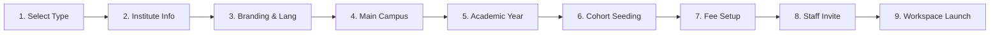
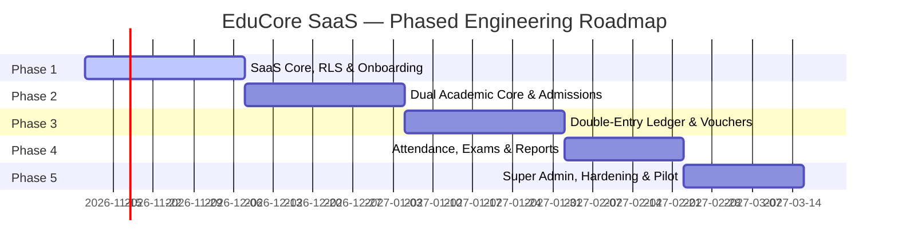

# EduCore SaaS — Architecture Refinement & Specification v2.0
**Document Version:** 2.0.0 (Enterprise Refinement)  
**Date:** November 2026  
**Status:** Architecture Refinement & Specification (Pre-Implementation)  

---

## 1. Technology Stack Compatibility & Version Strategy

### 1.1 Evaluated Ecosystem & Recommended Production Versions (November 2026)

| Layer | Evaluated Options | Recommended Version | Compatibility & Architectural Rationale |
| :--- | :--- | :--- | :--- |
| **PHP Runtime** | PHP 8.3 vs PHP 8.4 | **PHP 8.3.15+ (Host Active)** / **PHP 8.4 Ready** | PHP 8.3 provides rock-solid ecosystem stability with typed class constants, json_validate, and mature extension support. PHP 8.4 property hooks and asymmetric visibility are fully supported. Host machine has `php-8.3.15` and `php-8.4.2` already installed in Laragon. |
| **Backend Framework** | Laravel 11.x vs 12.x vs 13.x | **Laravel 12.x Stable Baseline** (with Laravel 13 forward compatibility) | Laravel 12.x represents the proven enterprise LTS baseline with universal package compatibility (Spatie, Sanctum, Livewire). Laravel 13 features can be adopted without architectural breaking changes. |
| **Full-Stack UI Engine** | Livewire 3.5+ vs Livewire 4 | **Livewire 3.5+ Stable** (Targeting Livewire 4 features) | Livewire 3 provides battle-tested production stability, Alpine v3 integration, file upload handling, and wire:navigate SPA features. Architecture avoids any deprecated patterns to ensure 100% zero-friction migration to Livewire 4. |
| **Styling & Design System** | Tailwind CSS v3.4 vs Tailwind CSS v4.0 | **Tailwind CSS v4.0** | Tailwind v4's CSS-first `@theme` configuration, zero-config Rust compiler engine, and first-class native CSS Logical Properties (`margin-inline-start`, `padding-inline-end`) provide superior performance for dynamic LTR/RTL switching. |
| **Relational Database** | PostgreSQL 15 vs 16 vs 17 | **PostgreSQL 15.15 (Host Active)** / Compatible with 16 & 17 | PostgreSQL 15.15 is installed locally. Features utilized: Native Row-Level Security (RLS), JSONB indexing, robust CHECK constraints, and generated columns. Zero proprietary extensions required. |
| **Cache & Queue Driver** | Redis 7.2+ | **Redis 7.2+** | Utilized for tenant-isolated cache tagging, queued voucher rendering, and high-frequency attendance buffer ingestion. |

### 1.2 Core Package Dependency Compatibility Matrix

* **Authentication & API:** `laravel/sanctum` (v4.0+) — Lightweight, multi-guard token authentication for SPA, Web, and future mobile apps.
* **Authorization:** `spatie/laravel-permission` (v6.0+) — Scoped strictly by `tenant_id` and `branch_id`.
* **Localization & RTL:** Native Laravel JSON translation dictionaries + custom `DirectionalLayoutMiddleware` with RTL font bundling.
* **PDF Engine:** `barryvdh/laravel-dompdf` (fallback) & `spatie/browsershot` (Puppeteer/Chromium) for complex Urdu Nastaliq typography and 3-part bank voucher generation.
* **Excel & CSV Exports:** `openspout/openspout` (via lightweight custom streaming exporter) for memory-safe generation of 10,000+ student ledgers.

---

## 2. Hardened Multi-Tenant Security Architecture

### 2.1 The Reality of Row-Level Security (RLS)
> [!WARNING]
> Row-Level Security is an indispensable defense-in-depth barrier, but **it is not automatically foolproof**. RLS can be silently bypassed if:
> 1. The application connects using a database superuser or a role with the `BYPASSRLS` attribute.
> 2. `FORCE ROW LEVEL SECURITY` is omitted, allowing table owners to bypass policies.
> 3. Connection poolers (e.g., PgBouncer in transaction mode) recycle connections where session state was not properly isolated.
> 4. Un-scoped background queue workers execute without establishing tenant context.

EduCore enforces a **Three-Tier Isolation Shield**:

```
[ HTTP Request / Webhook / Queue Job ]
                 |
                 v
   +----------------------------+
   | Tier 1: Tenant Resolution  |  --> (Subdomain / Domain / Queue Payload)
   +----------------------------+
                 |
                 v
   +----------------------------+
   | Tier 2: Eloquent Scoping   |  --> (Global Scope: WHERE tenant_id = current_tenant_id)
   +----------------------------+
                 |
                 v
   +----------------------------+
   | Tier 3: PostgreSQL RLS     |  --> (DB-Level: SET LOCAL app.current_tenant_id = '...')
   +----------------------------+
                 |
                 v
     [ Filtered Database Rows ]
```

### 2.2 PostgreSQL Database Role Separation
EduCore provisions two distinct database roles:

1. **`educore_migrator` (DDL Role):**
   * Owns tables, views, and indexes.
   * Runs database migrations and schema updates.
   * Never used by the web application runtime.
2. **`educore_app` (DML Runtime Role):**
   * Granted `SELECT`, `INSERT`, `UPDATE`, `DELETE` on tenant tables.
   * `NOBYPASSRLS` attribute explicitly set.
   * `NOSUPERUSER` attribute explicitly set.

### 2.3 RLS Policy Definition & `FORCE ROW LEVEL SECURITY`
Every tenant-scoped table is defined with mandatory RLS enforcement:

```sql
-- Example for students table
ALTER TABLE students ENABLE ROW LEVEL SECURITY;
ALTER TABLE students FORCE ROW LEVEL SECURITY; -- Critical: Forces RLS even on table owners

CREATE POLICY tenant_isolation_policy ON students
    AS RESTRICTIVE
    FOR ALL
    TO educore_app
    USING (tenant_id = NULLIF(current_setting('app.current_tenant_id', true), '')::uuid)
    WITH CHECK (tenant_id = NULLIF(current_setting('app.current_tenant_id', true), '')::uuid);
```

### 2.4 Transaction-Safe Context & Connection Pooling (PgBouncer)
In high-concurrency environments, connection pooling in **Transaction Mode** resets session-level variables (`SET app.current_tenant_id`) between transactions, or worse, leaks them to another request if using `SET SESSION`.

**Architectural Rules:**
1. **Always Use `SET LOCAL`:** `SET LOCAL app.current_tenant_id = 'xxx';` applies *only* to the current transaction block.
2. **Transaction Scoping:** All tenant-scoped operations execute within a managed transaction or utilize a verified database connection check-out hook:
   ```php
   DB::transaction(function () use ($tenantId, $callback) {
       DB::statement("SET LOCAL app.current_tenant_id = ?", [$tenantId]);
       return $callback();
   });
   ```
3. **Safety Fallback:** If `app.current_tenant_id` is empty or null, the RLS policy evaluates to `NULLIF('', '')::uuid` $\rightarrow$ `NULL`, which fails any equality check (`tenant_id = NULL` is FALSE in SQL), returning **zero rows** rather than leaking data.

### 2.5 Background Jobs & Queue Context
Queue workers run asynchronously outside HTTP request lifecycles.
* Every queueable job implements a `TenantAwareJob` interface.
* Job payloads serialize the active `tenant_id`.
* The job's pipeline executes `TenantQueueMiddleware`:
  ```php
  class TenantQueueMiddleware
  {
      public function handle($job, $next)
      {
          $tenant = Tenant::findOrFail($job->tenantId);
          app(TenantContext::class)->setTenant($tenant);
          
          DB::statement("SET LOCAL app.current_tenant_id = ?", [$tenant->id]);
          
          try {
              return $next($job);
          } finally {
              app(TenantContext::class)->clear();
          }
      }
  }
  ```

### 2.6 Cache & File Storage Isolation
* **Cache Partitioning:** Cache keys are strictly prefixed via a custom tagged manager: `tenants:{tenant_id}:{subsystem}:{key}`. Calling `Cache::tags(["tenant:{$id}"])->flush()` safely purges tenant cache without touching other tenants.
* **File Storage Isolation:**
  * Files are stored under private paths: `storage/app/tenants/{tenant_uuid}/{module}/{file_uuid}.{ext}`.
  * Public web access is completely disabled.
  * All access occurs via an authenticated controller: `GET /documents/{document_id}` verifying `tenant_id` ownership, RBAC permissions, and generating a 60-second time-limited signed stream.

### 2.7 Cross-Tenant Automated Security Test Suite
A dedicated Pest/PHPUnit test suite runs before every deployment:
* `test_tenant_a_cannot_read_tenant_b_students()`
* `test_raw_query_without_where_clause_still_filters_by_tenant_via_rls()`
* `test_null_tenant_context_returns_empty_result_set()`
* `test_cross_tenant_foreign_key_injection_fails_with_foreign_key_violation()`
* `test_signed_document_url_fails_when_accessed_by_different_tenant_user()`

---

## 3. Discrete Academic Domain Architecture

To eliminate leaky abstractions, **Schools** and **Academies** have distinct, normalized relational models. Common entities (Students, Guardians, Teachers, Subjects) are shared, while operational hierarchies remain strictly separate.

```
                           +------------------------+
                           |  SHARED CORE DOMAIN    |
                           |  * Tenants & Branches  |
                           |  * Students & Guardians|
                           |  * Teachers & Staff    |
                           |  * Master Subjects     |
                           +------------------------+
                                       |
                 +---------------------+---------------------+
                 |                                           |
                 v                                           v
+----------------------------------+       +-----------------------------------+
|      SCHOOL ACADEMIC DOMAIN      |       |      ACADEMY ACADEMIC DOMAIN      |
+----------------------------------+       +-----------------------------------+
| * academic_sessions              |       | * academy_programs                |
| * school_classes                 |       | * academy_courses                 |
| * school_sections                |       | * academy_batches                 |
| * school_class_subjects          |       | * academy_batch_schedules         |
| * school_student_enrollments     |       | * academy_batch_enrollments       |
| * school_promotions              |       | * academy_course_completions      |
+----------------------------------+       +-----------------------------------+
```

### 3.1 School Academic Schema (Normalized)
* **`academic_sessions`:** `id`, `tenant_id`, `name` (e.g., "2026-2027"), `start_date`, `end_date`, `is_current`.
* **`school_classes`:** `id`, `tenant_id`, `branch_id`, `name` (e.g., "Grade 9", "O-Level 1"), `numeric_level` (e.g., 9), `display_order`.
* **`school_sections`:** `id`, `tenant_id`, `school_class_id`, `name` (e.g., "Section Blue"), `room_number`, `max_capacity`, `class_teacher_id` (FK to `staff`).
* **`school_class_subjects`:** `id`, `tenant_id`, `school_class_id`, `subject_id`, `is_elective`, `credit_hours`, `pass_marks`, `total_marks`.
* **`school_student_enrollments`:**
  * Maps a student to an academic session, class, and section.
  * Columns: `id`, `tenant_id`, `student_id`, `academic_session_id`, `school_section_id`, `roll_number`, `enrollment_status` (`active`, `promoted`, `retained`, `withdrawn`), `enrolled_at`.
  * Unique Constraint: `(tenant_id, academic_session_id, student_id)` — A school student can only be enrolled in **one** section per session.
* **`school_promotions`:** Audits student progression: `id`, `tenant_id`, `from_session_id`, `to_session_id`, `from_section_id`, `to_section_id`, `student_id`, `result_summary`, `promoted_by_user_id`, `promoted_at`.

### 3.2 Academy Academic Schema (Normalized)
* **`academy_programs`:** `id`, `tenant_id`, `branch_id`, `name` (e.g., "MDCAT Entry Test Preparation", "Evening Matric Coaching"), `category`, `status`.
* **`academy_courses`:** `id`, `tenant_id`, `academy_program_id`, `name` (e.g., "MDCAT Physics Intensive"), `duration_weeks`, `billing_type` (`fixed_course_fee`, `per_subject`, `monthly_installment`).
* **`academy_batches`:** `id`, `tenant_id`, `academy_course_id`, `branch_id`, `name` (e.g., "Evening Batch 2026-A"), `start_date`, `end_date`, `max_capacity`, `instructor_id` (FK to `staff`), `status` (`upcoming`, `in_progress`, `completed`, `cancelled`).
* **`academy_batch_schedules`:** `id`, `tenant_id`, `academy_batch_id`, `day_of_week` (1–7), `start_time`, `end_time`, `room_number`.
* **`academy_batch_enrollments`:**
  * Maps a student to a batch.
  * Columns: `id`, `tenant_id`, `student_id`, `academy_batch_id`, `fee_schedule_type`, `agreed_fee_amount`, `enrollment_status` (`active`, `completed`, `dropped`), `enrolled_at`.
  * Multi-Enrollment Capability: A student can have **multiple active batch enrollments** simultaneously across different courses (e.g., Physics Batch A and Chemistry Batch B).
* **`academy_course_completions`:** `id`, `tenant_id`, `student_id`, `academy_course_id`, `completion_date`, `final_grade_or_score`, `certificate_number`, `issued_at`.

---

## 4. Complete Double-Entry Financial Architecture

EduCore incorporates a **Strict Double-Entry General Ledger** ensuring financial auditability, zero silent mutations, and regulatory compliance.

### 4.1 Core Accounting Principles
1. **Debit = Credit:** Every financial event creates a `journal_entry` where $\sum \text{Debits} = \sum \text{Credits}$.
2. **Immutable Posted Entries:** Once a journal entry is marked `posted`, it can **never** be edited or deleted.
3. **Reversal & Correction Ledger:** Errors are resolved strictly via compensating Reversal Entries or Credit Memos.

### 4.2 Standard Chart of Accounts (Default Tenant Hierarchy)

```
1000 - ASSETS
  ├── 1010 Cash on Hand (Vault / Office Cashier)
  ├── 1020 Cash in Bank (Main Operational Account)
  ├── 1030 Mobile Wallets (JazzCash / Easypaisa Transit)
  └── 1200 Accounts Receivable - Student Fees
2000 - LIABILITIES
  ├── 2010 Unearned / Advance Student Fees
  └── 2020 Security Deposits Payable
3000 - EQUITY
  └── 3010 Retained Earnings
4000 - REVENUE
  ├── 4010 Tuition Fee Revenue
  ├── 4020 Admission & Registration Fee Revenue
  ├── 4030 Examination Fee Revenue
  ├── 4040 Laboratory & Computer Fund
  ├── 4050 Course & Batch Fee Revenue (Academy)
  └── 4090 Late Payment Fine Revenue
5000 - EXPENSES & DISCOUNTS
  ├── 5010 Student Fee Discounts & Scholarships (Contra-Revenue)
  └── 5020 Bad Debt Write-Offs
```

### 4.3 Database Schema: General Ledger & Cashier Sessions

```sql
-- 1. Chart of Accounts
CREATE TABLE chart_of_accounts (
    id UUID PRIMARY KEY DEFAULT gen_random_uuid(),
    tenant_id UUID NOT NULL REFERENCES tenants(id) ON DELETE RESTRICT,
    branch_id UUID REFERENCES branches(id) ON DELETE RESTRICT,
    account_code VARCHAR(30) NOT NULL,
    account_name VARCHAR(150) NOT NULL,
    account_type VARCHAR(30) NOT NULL CHECK (account_type IN ('asset', 'liability', 'equity', 'revenue', 'expense')),
    normal_balance VARCHAR(10) NOT NULL CHECK (normal_balance IN ('debit', 'credit')),
    is_system BOOLEAN NOT NULL DEFAULT FALSE,
    parent_id UUID REFERENCES chart_of_accounts(id),
    created_at TIMESTAMPTZ NOT NULL DEFAULT NOW(),
    updated_at TIMESTAMPTZ NOT NULL DEFAULT NOW(),
    CONSTRAINT uk_tenant_account_code UNIQUE (tenant_id, account_code)
);

-- 2. Journal Entries (Master Header)
CREATE TABLE journal_entries (
    id UUID PRIMARY KEY DEFAULT gen_random_uuid(),
    tenant_id UUID NOT NULL REFERENCES tenants(id) ON DELETE RESTRICT,
    branch_id UUID NOT NULL REFERENCES branches(id) ON DELETE RESTRICT,
    entry_number VARCHAR(50) NOT NULL,
    entry_date DATE NOT NULL,
    status VARCHAR(20) NOT NULL DEFAULT 'draft' CHECK (status IN ('draft', 'posted', 'reversed')),
    source_type VARCHAR(50) NOT NULL, -- 'fee_invoice', 'payment', 'cashier_closing', 'manual_adjustment'
    source_id UUID,
    memo TEXT,
    posted_by_user_id UUID REFERENCES users(id),
    posted_at TIMESTAMPTZ,
    reversed_by_entry_id UUID REFERENCES journal_entries(id),
    created_at TIMESTAMPTZ NOT NULL DEFAULT NOW(),
    updated_at TIMESTAMPTZ NOT NULL DEFAULT NOW(),
    CONSTRAINT uk_tenant_entry_number UNIQUE (tenant_id, entry_number)
);

-- 3. Journal Entry Lines (Detail)
CREATE TABLE journal_entry_lines (
    id UUID PRIMARY KEY DEFAULT gen_random_uuid(),
    tenant_id UUID NOT NULL REFERENCES tenants(id) ON DELETE RESTRICT,
    journal_entry_id UUID NOT NULL REFERENCES journal_entries(id) ON DELETE CASCADE,
    account_id UUID NOT NULL REFERENCES chart_of_accounts(id) ON DELETE RESTRICT,
    entry_type VARCHAR(10) NOT NULL CHECK (entry_type IN ('debit', 'credit')),
    amount NUMERIC(14, 2) NOT NULL CHECK (amount > 0),
    description VARCHAR(255),
    created_at TIMESTAMPTZ NOT NULL DEFAULT NOW()
);

-- 4. Fee Invoices (Sub-Ledger Header)
CREATE TABLE fee_invoices (
    id UUID PRIMARY KEY DEFAULT gen_random_uuid(),
    tenant_id UUID NOT NULL REFERENCES tenants(id) ON DELETE RESTRICT,
    branch_id UUID NOT NULL REFERENCES branches(id) ON DELETE RESTRICT,
    student_id UUID NOT NULL REFERENCES students(id) ON DELETE RESTRICT,
    invoice_number VARCHAR(50) NOT NULL,
    issue_date DATE NOT NULL,
    due_date DATE NOT NULL,
    subtotal_amount NUMERIC(14, 2) NOT NULL DEFAULT 0,
    discount_amount NUMERIC(14, 2) NOT NULL DEFAULT 0,
    fine_amount NUMERIC(14, 2) NOT NULL DEFAULT 0,
    total_amount NUMERIC(14, 2) NOT NULL DEFAULT 0,
    paid_amount NUMERIC(14, 2) NOT NULL DEFAULT 0,
    status VARCHAR(30) NOT NULL DEFAULT 'unpaid' CHECK (status IN ('unpaid', 'partially_paid', 'paid', 'overdue', 'cancelled')),
    journal_entry_id UUID REFERENCES journal_entries(id),
    created_at TIMESTAMPTZ NOT NULL DEFAULT NOW(),
    updated_at TIMESTAMPTZ NOT NULL DEFAULT NOW(),
    CONSTRAINT uk_tenant_invoice_number UNIQUE (tenant_id, invoice_number)
);

-- 5. Fee Invoice Items (Line-level Fee Breakdown)
CREATE TABLE fee_invoice_items (
    id UUID PRIMARY KEY DEFAULT gen_random_uuid(),
    tenant_id UUID NOT NULL REFERENCES tenants(id) ON DELETE RESTRICT,
    fee_invoice_id UUID NOT NULL REFERENCES fee_invoices(id) ON DELETE CASCADE,
    fee_category VARCHAR(50) NOT NULL, -- 'tuition', 'admission', 'exam', 'lab', 'transport'
    revenue_account_id UUID NOT NULL REFERENCES chart_of_accounts(id),
    amount NUMERIC(14, 2) NOT NULL CHECK (amount >= 0),
    discount_amount NUMERIC(14, 2) NOT NULL DEFAULT 0
);

-- 6. Cashier Sessions & Daily Cash Closing
CREATE TABLE cashier_sessions (
    id UUID PRIMARY KEY DEFAULT gen_random_uuid(),
    tenant_id UUID NOT NULL REFERENCES tenants(id) ON DELETE RESTRICT,
    branch_id UUID NOT NULL REFERENCES branches(id) ON DELETE RESTRICT,
    cashier_user_id UUID NOT NULL REFERENCES users(id) ON DELETE RESTRICT,
    opened_at TIMESTAMPTZ NOT NULL DEFAULT NOW(),
    closed_at TIMESTAMPTZ,
    opening_balance NUMERIC(14, 2) NOT NULL DEFAULT 0,
    expected_cash_balance NUMERIC(14, 2) NOT NULL DEFAULT 0,
    actual_counted_cash NUMERIC(14, 2),
    variance_amount NUMERIC(14, 2) GENERATED ALWAYS AS (actual_counted_cash - expected_cash_balance) STORED,
    closing_notes TEXT,
    supervisor_user_id UUID REFERENCES users(id),
    status VARCHAR(20) NOT NULL DEFAULT 'open' CHECK (status IN ('open', 'closed', 'verified')),
    closing_journal_entry_id UUID REFERENCES journal_entries(id)
);

-- 7. Fee Payments (Transactions)
CREATE TABLE fee_payments (
    id UUID PRIMARY KEY DEFAULT gen_random_uuid(),
    tenant_id UUID NOT NULL REFERENCES tenants(id) ON DELETE RESTRICT,
    branch_id UUID NOT NULL REFERENCES branches(id) ON DELETE RESTRICT,
    cashier_session_id UUID REFERENCES cashier_sessions(id) ON DELETE RESTRICT,
    receipt_number VARCHAR(50) NOT NULL,
    payment_date DATE NOT NULL,
    total_paid NUMERIC(14, 2) NOT NULL CHECK (total_paid > 0),
    payment_method VARCHAR(30) NOT NULL CHECK (payment_method IN ('cash', 'bank_transfer', 'cheque', 'jazzcash', 'easypaisa')),
    reference_number VARCHAR(100),
    received_by_user_id UUID NOT NULL REFERENCES users(id),
    journal_entry_id UUID REFERENCES journal_entries(id),
    created_at TIMESTAMPTZ NOT NULL DEFAULT NOW(),
    CONSTRAINT uk_tenant_receipt_number UNIQUE (tenant_id, receipt_number)
);

-- 8. Payment Allocations (Specific Invoices/Items Settled)
CREATE TABLE fee_payment_allocations (
    id UUID PRIMARY KEY DEFAULT gen_random_uuid(),
    tenant_id UUID NOT NULL REFERENCES tenants(id) ON DELETE RESTRICT,
    fee_payment_id UUID NOT NULL REFERENCES fee_payments(id) ON DELETE CASCADE,
    fee_invoice_id UUID NOT NULL REFERENCES fee_invoices(id) ON DELETE RESTRICT,
    allocated_amount NUMERIC(14, 2) NOT NULL CHECK (allocated_amount > 0)
);
```

### 4.4 Transaction Execution Flow: Invoicing, Payment & Closing

#### Event 1: Monthly Fee Invoicing (PKR 10,000 Tuition with PKR 1,000 Sibling Concession)
```
Debit:  1200 Accounts Receivable               PKR 9,000
Debit:  5010 Student Fee Discounts (Contra)    PKR 1,000
Credit: 4010 Tuition Fee Revenue               PKR 10,000
(Total Debit = PKR 10,000 | Total Credit = PKR 10,000)
```

#### Event 2: Student Pays Over-the-Counter Cash (PKR 9,000)
```
Debit:  1010 Cash on Hand (Cashier Drawer)      PKR 9,000
Credit: 1200 Accounts Receivable                PKR 9,000
(Total Debit = PKR 9,000 | Total Credit = PKR 9,000)
```

#### Event 3: Daily Cash Closing & Bank Deposit (PKR 150,000 Deposited in Bank)
```
Debit:  1020 Cash in Bank                      PKR 150,000
Credit: 1010 Cash on Hand                      PKR 150,000
(Total Debit = PKR 150,000 | Total Credit = PKR 150,000)
```

---

## 5. Privacy, PII Encryption & Security Architecture

### 5.1 Sensitive Identity Data (CNIC / B-Form Protection)
Under Pakistani data protection frameworks and international security best practices:
1. **Never Used as Default Login:** Login authentication uses the unique `Admission Number` or verified `Mobile/Email` + Password/OTP.
2. **Encrypted at Rest:** National identity numbers (CNIC / B-Form) are encrypted using AES-256-CBC via Laravel’s `encrypted` attribute.
3. **Deterministic Blind Indexing for Querying:** To allow lookups (e.g., checking for duplicate admissions or searching by B-Form) without storing plaintext or decrypting entire tables, we compute a salted HMAC-SHA256 blind index:
   $$\text{b\_form\_blind\_index} = \text{HMAC-SHA256}(\text{normalized\_b\_form}, \text{APP\_BLIND\_INDEX\_KEY})$$
   Queries execute against `WHERE b_form_blind_index = :hash`.

### 5.2 Private File Storage & Temporary Signed Access
* **Storage Path:** `tenants/{tenant_id}/student_documents/{student_id}/{random_uuid}.pdf`.
* **Zero Public Symlinks:** No files are stored in `public/` or accessed directly via web servers.
* **Controller Stream with Gate Validation:**
  ```php
  public function download(Document $document)
  {
      Gate::authorize('view', $document);
      
      DocumentAccessLog::create([
          'tenant_id' => tenant('id'),
          'user_id' => auth()->id(),
          'document_id' => $document->id,
          'action' => 'download',
          'ip_address' => request()->ip(),
      ]);
      
      return Storage::disk('private')->response($document->file_path, $document->original_filename);
  }
  ```

### 5.3 Audit Trails & Account Recovery
* **PII Access Logging:** Any decryption or export of student national IDs or emergency contacts generates an entry in `security_audit_logs`.
* **Account Recovery Security:** Password recovery never asks for B-Form or mother's maiden name. It requires dual-factor confirmation via an authenticated SMS/WhatsApp OTP sent to the registered guardian mobile number.

---

## 6. Configurable SaaS Subscription & Monetization Engine

### 6.1 Data-Driven Plan & Feature Flags Schema
Plan limits, pricing, and feature access are 100% database-driven and configurable via the Super Admin UI without deploying code.

```sql
CREATE TABLE plans (
    id UUID PRIMARY KEY DEFAULT gen_random_uuid(),
    code VARCHAR(50) UNIQUE NOT NULL, -- 'starter', 'growth', 'enterprise'
    name VARCHAR(100) NOT NULL,
    description TEXT,
    currency VARCHAR(10) NOT NULL DEFAULT 'PKR',
    monthly_price NUMERIC(10, 2) NOT NULL,
    annual_price NUMERIC(10, 2) NOT NULL,
    trial_days INT NOT NULL DEFAULT 14,
    is_active BOOLEAN NOT NULL DEFAULT TRUE,
    created_at TIMESTAMPTZ NOT NULL DEFAULT NOW(),
    updated_at TIMESTAMPTZ NOT NULL DEFAULT NOW()
);

CREATE TABLE plan_limits (
    id UUID PRIMARY KEY DEFAULT gen_random_uuid(),
    plan_id UUID NOT NULL REFERENCES plans(id) ON DELETE CASCADE,
    metric_code VARCHAR(50) NOT NULL, -- 'max_students', 'max_branches', 'max_staff', 'storage_mb'
    metric_value INT NOT NULL, -- -1 represents unlimited
    CONSTRAINT uk_plan_metric UNIQUE (plan_id, metric_code)
);

CREATE TABLE tenant_subscriptions (
    id UUID PRIMARY KEY DEFAULT gen_random_uuid(),
    tenant_id UUID NOT NULL REFERENCES tenants(id) ON DELETE CASCADE,
    plan_id UUID NOT NULL REFERENCES plans(id) ON DELETE RESTRICT,
    billing_interval VARCHAR(20) NOT NULL CHECK (billing_interval IN ('monthly', 'annual')),
    starts_at TIMESTAMPTZ NOT NULL,
    ends_at TIMESTAMPTZ NOT NULL,
    trial_ends_at TIMESTAMPTZ,
    status VARCHAR(30) NOT NULL CHECK (status IN ('trialing', 'active', 'past_due', 'suspended', 'cancelled')),
    grace_period_ends_at TIMESTAMPTZ,
    created_at TIMESTAMPTZ NOT NULL DEFAULT NOW(),
    updated_at TIMESTAMPTZ NOT NULL DEFAULT NOW()
);

CREATE TABLE subscription_invoices (
    id UUID PRIMARY KEY DEFAULT gen_random_uuid(),
    tenant_id UUID NOT NULL REFERENCES tenants(id) ON DELETE CASCADE,
    subscription_id UUID NOT NULL REFERENCES tenant_subscriptions(id) ON DELETE RESTRICT,
    invoice_number VARCHAR(50) UNIQUE NOT NULL,
    amount NUMERIC(10, 2) NOT NULL,
    status VARCHAR(30) NOT NULL DEFAULT 'pending' CHECK (status IN ('pending', 'under_review', 'paid', 'rejected')),
    proof_of_payment_path TEXT, -- uploaded deposit slip
    verified_by_user_id UUID,
    verified_at TIMESTAMPTZ,
    created_at TIMESTAMPTZ NOT NULL DEFAULT NOW()
);
```

### 6.2 Manual Bank Slip Approval Workflow
1. Tenant uploads image/PDF of bank deposit slip / 1Link transfer receipt.
2. Status transitions to `under_review`.
3. Super Admin reviews receipt against platform bank statement and clicks **Verify & Activate**.
4. System automatically extends `ends_at` by 1 month or 1 year and resets `status` to `active`.

---

## 7. Institute Onboarding Wizard (Zero-Empty-State UX)

To prevent new administrators from landing on an empty, confusing screen, a 9-step state machine guides the setup and seeds a usable workspace.



### Onboarding Steps & Pre-Seeding Logic
* **Step 1: Institute Type:** Choose `School` or `Academy / Coaching Center`. (Configures UI navigation and active modules).
* **Step 2: Legal Profile:** Name, Institute Registration Number, Official Contact & Address.
* **Step 3: Branding & Locale:** Upload logo, select primary color, choose default UI language (`English` LTR or `Urdu` RTL).
* **Step 4: Primary Branch:** Set up Main Campus code, city, and address.
* **Step 5: Academic Calendar:** Set current session start/end date, weekly working days (e.g., Mon–Sat).
* **Step 6: Cohort Seeding (One-Click Starter Templates):**
  * *For Schools:* One-click seed standard Pakistani grades (e.g., Primary: Class 1–5, Middle: 6–8, Matric: 9–10) with Section 'A' auto-created.
  * *For Academies:* One-click seed standard programs (e.g., "Evening Coaching" or "MDCAT Prep") with starter courses.
* **Step 7: Financial Setup:** Seed default Chart of Accounts, set monthly tuition billing due date (e.g., 5th of each month) and late fine rule.
* **Step 8: Staff Invitations:** Add 1–3 key staff members (Principal, Head Cashier) with email/SMS invitations.
* **Step 9: Launch Workspace:** Flags `onboarding_completed = true` and presents a populated, actionable dashboard.

---

## 8. Revised MVP Scope & Realistic Milestone Roadmap

Rather than an arbitrary single delivery date, the MVP is structured into **5 Gated Milestones** with explicit acceptance criteria.



### Milestone Specifications

#### Phase 1: Core SaaS Foundation, Security & Onboarding (Weeks 1–4)
* **Deliverables:** Tenant resolution (subdomains), PostgreSQL RLS policies, RBAC system, 9-step Onboarding Wizard, Tailwind v4 bilingual layout (EN LTR / UR RTL).
* **Acceptance Criteria:** Passing cross-tenant security test suite; completed wizard seeds a usable workspace.

#### Phase 2: Dual Academic Core & Admissions (Weeks 5–8)
* **Deliverables:** Normalized School domain (Classes, Sections, Subjects) and Academy domain (Programs, Courses, Batches); Student admissions with encrypted B-Form and blind index lookups.
* **Acceptance Criteria:** School students enrolled in single section; academy students enrolled in multiple independent batches.

#### Phase 3: Double-Entry Financial Engine & 3-Part Vouchers (Weeks 9–12)
* **Deliverables:** Chart of Accounts, Journal Entries, Cashier Sessions, Invoice generation, Over-the-counter payments, Printable 3-part bilingual PDF fee vouchers.
* **Acceptance Criteria:** $\sum \text{Debits} = \sum \text{Credits}$ invariant test; cashier daily cash closing balances accurately.

#### Phase 4: Attendance, Assessments & Bilingual Report Cards (Weeks 13–15)
* **Deliverables:** Daily school attendance grid, academy batch session attendance, exam mark sheets, bilingual PDF report cards.
* **Acceptance Criteria:** Attendance summaries calculate accurately; Urdu font ligatures render cleanly on generated PDFs.

#### Phase 5: Super Admin Monetization, Security Audit & Pilot (Weeks 16–18)
* **Deliverables:** Super Admin control plane, Plan feature quota enforcement, bank slip verification, penetration testing, performance optimization.
* **Acceptance Criteria:** Zero critical vulnerabilities in security scan; smooth commercial pilot execution.

---

## 9. Architecture Decision Records (ADRs)

### ADR-001: Technology Stack Baseline & Version Strategy
* **Status:** Accepted.
* **Context:** Need a modern, ultra-reliable stack for high-density multi-tenant SaaS in late 2026.
* **Decision:** Standardize on PHP 8.3/8.4, Laravel 12.x baseline with Livewire 3.5+ (structured for Livewire 4 migration), Tailwind CSS v4, and PostgreSQL 15.15+.
* **Consequences:** Maximizes stability and existing package compatibility while leveraging native modern features.

### ADR-002: Multi-Layered Multi-Tenancy with PostgreSQL RLS
* **Status:** Accepted.
* **Context:** Single-database multi-tenancy requires strict isolation guarantees without astronomical per-database hosting overhead.
* **Decision:** Combine Eloquent Global Scopes with PostgreSQL Native Row-Level Security (`FORCE ROW LEVEL SECURITY`), coupled with a non-superuser application database role and `SET LOCAL app.current_tenant_id` per transaction.
* **Consequences:** Eliminates accidental cross-tenant data leaks at the database engine level without connection pool bloat.

### ADR-003: Discrete Domain Separation for Schools vs. Academies
* **Status:** Accepted.
* **Context:** Forcing tuition academies into a `Class -> Section` structure leads to fragile polymorphic workarounds.
* **Decision:** Maintain separate, normalized database tables for School operations (`school_classes`, `school_sections`) and Academy operations (`academy_programs`, `academy_courses`, `academy_batches`), while sharing core entities (`students`, `staff`, `subjects`).
* **Consequences:** Clean domain boundaries, simple queries, and zero business rule pollution between the two models.

### ADR-004: Strict Double-Entry General Ledger for All Financial Events
* **Status:** Accepted.
* **Context:** Education SaaS systems suffer severe trust issues if fee collections cannot be reconciled with financial integrity.
* **Decision:** Implement a true double-entry ledger (`chart_of_accounts`, `journal_entries`, `journal_entry_lines`) where posted transactions are immutable and must balance ($\text{Debits} = \text{Credits}$).
* **Consequences:** Bulletproof audit trails, support for cashier shifts, and ready compatibility with formal accounting audits.

### ADR-005: Field-Level Encryption & Blind Indexing for Student PII
* **Status:** Accepted.
* **Context:** B-Form and CNIC identity documents are sensitive PII that must be protected while still allowing fast uniqueness checks.
* **Decision:** Encrypt identity numbers using AES-256-CBC at rest; store an HMAC-SHA256 blind index for exact-match searches; disallow CNIC as the default login username.
* **Consequences:** Robust data protection compliance without sacrificing search performance.

---

## 10. Remaining Decisions Requiring Your Approval

Before we proceed to Milestone 1 implementation, please review and approve the following final decisions:

1. **Subdomain Strategy:** Confirm your preferred staging/production root domain for tenant subdomains (e.g., `*.educore.pk` or `*.educore.test` for local development).
2. **PDF Generation Dependency:** Confirm approval to require Node/Puppeteer on the server for `spatie/browsershot` (ensuring perfect Urdu Nastaliq font ligatures on vouchers) or whether we should start with a zero-Node PHP-native PDF engine (`mpdf/mpdf`).
3. **Phased Roadmap Approval:** Confirm acceptance of the refined 18-week phased milestone plan (5 gated phases).
