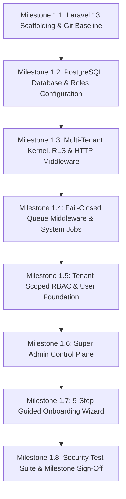

# EduCore SaaS — Phase 1 Execution Plan
**Milestone:** Phase 1: SaaS Foundation, Multi-Tenant Isolation, RBAC and Institute Onboarding  
**Framework:** Laravel 13 on PHP 8.3.15+ / PostgreSQL 16.10 (Port 5432)  
**Remote Git Repo:** `https://github.com/engr-owais09/sms.git`  
**Status:** In Progress  

---

## 1. Overview & Objectives
Phase 1 establishes the rock-solid, production-ready foundation for the entire EduCore SaaS platform. It strictly enforces:
1. Multi-tenant isolation at both Application (Eloquent) and Database (PostgreSQL RLS) levels.
2. Parameter-safe transaction lifecycle and connection-pool safety (`set_config`).
3. Fail-closed tenant queue execution preventing silent data contamination.
4. Tenant-scoped Role-Based Access Control (RBAC).
5. Centralized Super Admin control plane.
6. A guided 9-step Institute Onboarding Wizard with zero-empty-state template seeding.

---

## 2. Implementation Milestones & Work Breakdown

### Milestone 1.1: Laravel Application Foundation & Baseline Scaffolding
* Initialize clean Laravel application inside the repository workspace using PHP 8.3.15 and Composer.
* Configure Git default branch (`main`), `.gitignore` for Windows/Laravel, initial documentation commit, and repository remote link.
* Install core dependencies: `spatie/laravel-permission`, `laravel/sanctum`, Livewire, Alpine.js, Tailwind CSS v4.

### Milestone 1.2: PostgreSQL Database & Migration Infrastructure
* Provision database: `educore_saas` on PostgreSQL (port 5432).
* Provision dual database roles:
  * `educore_migrator`: DDL ownership role for migrations.
  * `educore_app`: Unprivileged DML runtime role (`NOBYPASSRLS`, `NOSUPERUSER`).
* Configure Laravel database connections in `config/database.php`.
* Create foundational migrations:
  * `tenants` (UUID, name, slug, type [school|academy], default_locale [en|ur], status [trial|active|suspended], onboarding_step, onboarding_completed, settings JSONB).
  * `branches` (UUID, tenant_id, name, code, city, address, is_main, status).
  * `domains` (UUID, tenant_id, domain, is_primary, is_verified).

### Milestone 1.3: PostgreSQL RLS Policies & HTTP Tenant Context Lifecycle
* Apply `ENABLE ROW LEVEL SECURITY` and `FORCE ROW LEVEL SECURITY` across tenant tables.
* Implement parameter-safe `PostgresTenantContext::set($tenantId)` using `SELECT set_config('app.current_tenant_id', ?, true)`.
* Implement `TenantContext` application singleton to hold active tenant state.
* Implement `BelongsToTenant` Eloquent trait with `TenantScope` (appends `WHERE tenant_id = current_tenant_id`).
* Implement `IdentifyTenantBySubdomain` HTTP middleware to resolve subdomains on `educore.test`.
* Implement `TenantTransactionManager::run()` guaranteeing transaction-scoped setting and automatic cleanup.

### Milestone 1.4: Fail-Closed Queue Middleware & System Job Architecture
* Define marker interfaces: `TenantAwareJob` and `PlatformSystemJob`.
* Implement `EnforceTenantQueueMiddleware`:
  * Aborts with `MissingTenantContextException` if a job lacks a valid tenant ID or tenant does not exist.
  * Aborts with `TenantSuspendedException` if tenant is suspended.
  * Permits `PlatformSystemJob` to execute in system maintenance scope without tenant context.
  * Establishes `PostgresTenantContext` inside transaction and guarantees reset in `finally`.

### Milestone 1.5: Tenant-Scoped RBAC & User Foundation
* Configure `spatie/laravel-permission` with `teams => true` and `team_foreign_key => 'tenant_id'`.
* Define core platform roles (Super Admin) and tenant-level roles (Institute Owner, Branch Admin, Accountant, Teacher, Staff, Student, Guardian).
* Define permissions matrix with granular guard policies.
* Seed default roles and platform Super Admin user.

### Milestone 1.6: Super Admin Control Plane
* Secure `/super-admin` route group protected by `auth` and `Role:super_admin`.
* Super Admin dashboard metrics: total institutes, active vs. suspended institutes, student count, storage metrics.
* Institute management: tenant list, status toggling (active $\leftrightarrow$ suspended), and branch inspector.

### Milestone 1.7: 9-Step Guided Institute Onboarding Wizard
* Livewire 3 full-stack wizard supporting bidirectional English LTR and Urdu RTL.
* Multi-step state machine with resume support (`onboarding_step` 1 to 9):
  1. Institute Type selection (`school` vs `academy`).
  2. Legal Information.
  3. Branding & Localization (Color, Logo, default language).
  4. Primary Campus / Branch configuration.
  5. Academic Year / Session dates.
  6. Cohort / Class / Course starter templates.
  7. Fee setup & Chart of Accounts initialization.
  8. Staff invitations.
  9. Workspace Launch (seeds initial data and redirects to populated dashboard).

### Milestone 1.8: Comprehensive Automated Testing Suite
* `CrossTenantIsolationTest`: Verifies zero data cross-talk between Tenant A and Tenant B.
* `MissingTenantContextTest`: Asserts that queries with missing tenant context return zero rows.
* `ConnectionPoolReuseTest`: Asserts that recycled connections do not leak previous tenant data.
* `TransactionRollbackTest`: Verifies that failed transactions cleanly reset `set_config`.
* `FailClosedQueueTest`: Tests that missing tenant ID on a queue job triggers `MissingTenantContextException`.
* `RbacPermissionTest`: Verifies tenant-scoped permission enforcement.

---

## 3. Acceptance Criteria for Phase 1 Sign-Off
1. [ ] Clean Laravel 13 foundation running on PHP 8.3 with zero dependency conflicts.
2. [ ] PostgreSQL database created with dual roles (`educore_migrator`, `educore_app`) and RLS enforced with `FORCE ROW LEVEL SECURITY`.
3. [ ] Subdomain resolution on `educore.test` correctly identifies tenants.
4. [ ] Queue worker fails closed when executing tenant jobs without valid context.
5. [ ] Onboarding wizard executes all 9 steps in both English and Urdu RTL, seeding a usable workspace.
6. [ ] 100% of security and tenant isolation tests pass in the automated test suite.
7. [ ] All changes committed to Git with clear, structured commit messages linked to GitHub remote.
