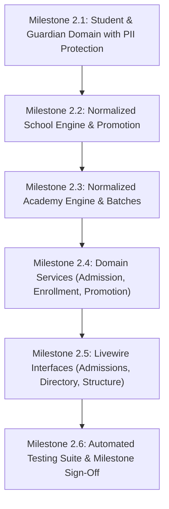

# EduCore SaaS — Phase 2 Execution Plan
**Milestone:** Phase 2: Dual Academic Core (School & Academy Engines) & Student Admissions  
**Framework:** Laravel 13 on PHP 8.3.15 / PostgreSQL 16  
**Remote Git Repo:** `https://github.com/engr-owais09/sms.git`  
**Status:** In Progress  

---

## 1. Overview & Objectives
Phase 2 builds the core academic domains and student lifecycle management, strictly maintaining the separation between **Formal K-12 Schools** and **Coaching Academies** while sharing master student identity and sensitive PII protection:
1. **Master Student & Guardian Domain:** Unique admission numbering, multi-ward guardian mapping, and encrypted national identity (B-Form/CNIC) with blind indexing.
2. **Normalized School Academic Engine:** Annual academic sessions, classes, sections, subject mappings, single-section annual enrollment constraint, and student promotions.
3. **Normalized Academy Engine:** Programs, courses, dynamic rolling batches, weekly slot timetables, multiple simultaneous batch enrollments, and course completion tracking.
4. **PostgreSQL RLS Enforcement:** Applying `ENABLE ROW LEVEL SECURITY` and `FORCE ROW LEVEL SECURITY` across all newly created student and academic tables.
5. **Fast Livewire 4 Interfaces:** Bilingual student admission form, student directory with instant filtering, and academic structure managers.
6. **Automated Verification:** Comprehensive test suite running on PostgreSQL covering single vs multi-enrollment constraints, PII protection, and cross-tenant isolation.

---

## 2. Work Breakdown & Milestones

### Milestone 2.1: Student & Guardian Domain with PII Protection
* Database migrations:
  * `subjects` (Master catalog: code, name, category, credit hours).
  * `students` (UUID, tenant_id, branch_id, admission_number UK, first_name, last_name, gender, dob, status, emergency_contact).
  * **Sensitive PII:** `b_form_encrypted` (AES-256) and `b_form_blind_index` (HMAC-SHA256).
  * `guardians` & `student_guardians` (Guardian network, relations, primary/billing/emergency flags).
  * `student_documents` (Private vault storage metadata).
* Apply PostgreSQL RLS policies to all student and guardian tables.

### Milestone 2.2: Normalized School Academic Engine
* Database migrations:
  * `academic_sessions` (Annual session dates, is_current).
  * `school_classes` (Grade levels, display order).
  * `school_sections` (Capacity, room number, class teacher FK, composite keys).
  * `school_class_subjects` (Subject allocations, elective flag, pass marks).
  * `school_student_enrollments` (Student FK, Session FK, Section FK, roll number; UNIQUE constraint on `[tenant_id, academic_session_id, student_id]`).
  * `school_promotions` (Audit log of promotions/reversals).
* Apply PostgreSQL RLS policies to school tables.

### Milestone 2.3: Normalized Academy Academic Engine
* Database migrations:
  * `academy_programs` (Program catalog, status).
  * `academy_courses` (Duration weeks, billing type).
  * `academy_batches` (Instructor FK, start/end dates, max capacity, status).
  * `academy_batch_schedules` (Slot timetables, day of week, times, room).
  * `academy_batch_enrollments` (Student FK, Batch FK, agreed fee; permits multiple active enrollments across batches).
  * `academy_course_completions` (Completion dates, certificate numbers).
* Apply PostgreSQL RLS policies to academy tables.

### Milestone 2.4: Domain Services & Logic
* `StudentAdmissionService`: generates tenant-scoped sequential admission numbers (`e.g. LGS-2026-0001`), computes B-Form blind index, and attaches guardians.
* `SchoolPromotionService`: executes bulk or individual student progression, handling pass/retain decisions.
* `AcademyEnrollmentService`: manages multi-course enrollments, checks seat capacity, and detects scheduling conflicts.

### Milestone 2.5: User Interfaces (Livewire 4)
* `StudentAdmissionForm`: dynamic form adapting to School (class/section select) vs Academy (multi-batch select).
* `StudentDirectory`: searchable, filterable table with status badges and quick view drawer.
* School Academic Manager & Academy Batch Manager views.

### Milestone 2.6: Automated Testing Suite
* Automated tests for:
  * B-Form encryption at rest & blind index querying.
  * School single-enrollment constraint enforcement.
  * Academy multi-batch simultaneous enrollment capability.
  * Promotion audit trail.
  * PostgreSQL RLS isolation on student and academic tables.

