# EduCore SaaS — Phase 3 Financial Architecture & Design Review
**Document Version:** v1.1.7  
**Status:** Approved Architecture Refinement (Pre-Implementation Baseline)  
**Author:** Principal SaaS Product Architect & Senior Laravel Engineer  
**Date:** November 2026  
**Target Milestone:** Phase 3: Financial Engine, Fee Vouchers, Installment Rules & Double-Entry Ledger  

---

## Document Revision History

| Version | Date | Author | Description of Changes |
| :--- | :--- | :--- | :--- |
| **v1.0.0** | 11-Nov-2026 | Principal SaaS Architect | Initial Phase 3 financial architecture review covering dual academic models, chart of accounts, proposed schemas, PostgreSQL ledger triggers, and cashier shift closing. |
| **v1.1.0** | 11-Nov-2026 | Principal SaaS Architect | Refinement incorporating revenue recognition policies, double-entry matrix, corrected RLS policy semantics, maker-checker refund workflows, and PDF benchmark specifications. |
| **v1.1.1** | 11-Nov-2026 | Principal SaaS Architect | Pre-implementation corrections on school revenue recognition, table inventory, academy installment traceability, bidirectional reversal pointers, and student credit reconciliation. |
| **v1.1.2** | 11-Nov-2026 | Principal SaaS Architect | Targeted accounting clarifications separating Student Credit Liability (`2025`) from Unearned Tuition Revenue (`2010`), immutable payment allocations with `fee_refund_allocations`, and specific invoice cancellation rules. |
| **v1.1.3** | 11-Nov-2026 | Principal SaaS Architect | **Pre-Implementation Accounting Validations:**<br>1. **Advance Tuition Accounting:** Delineated Scenario A and Scenario B; demonstrated debit/credit entries, sub-ledger movements, and zero double revenue recognition.<br>2. **Refund & Discount Consistency:** Formulated mathematical rules for partial refunds on concession-discounted invoices; defined proportional reversal of Account `5010 Student Fee Discounts`; enforced refund ceiling constraint.<br>3. **Journal Reversal Relationship Integrity:** Enforced bidirectional pointer consistency (`reverses_entry_id` vs `reversed_by_entry_id`) with row-level locking (`SELECT ... FOR UPDATE`) in PostgreSQL triggers.<br>4. **Remaining Accounting Assumptions:** Enumerated operational accounting assumptions. |
| **v1.1.4** | 11-Nov-2026 | Principal SaaS Architect | **Architecture Amendment — Student-Level Unearned Tuition Advance Sub-Ledger:**<br>1. **Dedicated Advance Sub-Ledger (`student_fee_advances`):** Introduced Table #15 to track student-specific prepayments for designated future billing periods under GL Account `2010 Unearned Tuition Revenue` (School) and `2015 Unearned Course Revenue` (Academy), expanding inventory from 22 to **23 physical tables**.<br>2. **Lifecycle & Concurrency Guards:** Formulated advance receipt, invoice auto-allocation, `SELECT ... FOR UPDATE` row-locking, `CHECK (remaining_balance >= 0)` double-spending protection, and refund/cancellation mechanics.<br>3. **Sub-Ledger Reconciliation:** Formally linked $\sum \text{student\_fee\_advances.remaining\_balance}$ to GL Accounts `2010` and `2015`, completely segregated from $\sum \text{student\_credit\_wallets.balance}$ ($\equiv \text{GL 2025}$). |
| **v1.1.5** | 12-Nov-2026 | Principal SaaS Architect | **Multiple Advance Receipts & Deterministic FIFO Allocation:**<br>1. **Multiple Receipts Support:** Redesigned uniqueness constraints on `student_fee_advances` by replacing `uk_student_advance_period` with payment-source idempotency `uk_advance_payment_source`, enabling multiple independent advance receipts (e.g. Rs. 5,000 + Rs. 3,000) for the same period/category.<br>2. **Deterministic FIFO Allocation:** Defined strict chronological allocation order (`receipt_date ASC, created_at ASC`) with row-level locking (`SELECT ... FOR UPDATE`) during invoice generation.<br>3. **Independent Auditability:** Ensured partial applications, individual advance refunds, invoice cancellation, and reversals remain independently traceable per receipt.<br>4. **Control Account Mapping:** Clarified automated mapping rules linking school tuition prepayments to GL `2010` and academy course prepayments to GL `2015`. |
| **v1.1.6** | 12-Nov-2026 | Principal SaaS Architect | **Targeted Architecture Consistency Refinements:**<br>1. **Receipt Creation Flow & `fee_payments` Verification:** Verified `fee_payments` counter receipt schema with explicit `student_id`; documented exact receipt-creation flow without invoice requirements.<br>2. **Dedicated Advance Allocations Sub-Ledger (`student_fee_advance_allocations`):** Introduced Table #16 to preserve $1:N$ allocations, partial applications, and independent reversal history, expanding inventory to **24 physical tables**.<br>3. **Concurrency & Deadlock Resolution:** Corrected deadlock claims; defined global entity lock hierarchy, short transaction boundaries, and bounded exponential backoff retries (`runWithRetry`) for PostgreSQL `40P01` deadlocks and `40001` serialization failures.<br>4. **GL 2010/2015 Reconciliation Boundary:** Enforced system control exclusivity via trigger `trg_guard_control_account_direct_posting` prohibiting manual journal entries on sub-ledger control accounts, and segregated unrelated deferred revenues (grants, bus passes) into separate GL accounts. |
| **v1.1.7** | 12-Nov-2026 | Principal SaaS Architect | **Final Targeted Architecture Consistency Hardening:**<br>1. **Allocation Idempotency & Nullable Uniqueness Fix:** Resolved PostgreSQL NULL uniqueness behavior by replacing multi-column unique with deterministic `allocation_reference` idempotency key and partial unique indexes for active allocations.<br>2. **Authoritative Sub-Ledger Sync (`student_fee_advance_allocations`):** Enforced database trigger `trg_sync_advance_applied_amount` making allocations table the sole authoritative source of truth for parent applied amounts.<br>3. **Payment-Source Equilibrium:** Formulated zero-drift identity proving $100\%$ payment allocation across invoices, advances, and credit wallet with zero double-counting.<br>4. **Waterfall GL Account Mapping:** Replaced ambiguous OR conditions with strict 3-tier deterministic priority waterfall.<br>5. **Enforceable Service Lock Protocol:** Specified `FinancialLockManager` runtime stage-validation throwing `LockOrderViolationException` on out-of-order lock requests. |

---

## 1. Executive Summary & Architectural Scope

The financial subsystem of EduCore is designed as an auditable, commercial-grade enterprise financial core built inside a multi-tenant modular monolith. It provides:
1. **Mathematical Ledger Integrity:** Financial balances are maintained in an immutable, double-entry General Ledger governed by PostgreSQL triggers enforcing $\sum \text{Debits} = \sum \text{Credits}$ and prohibiting deletion or tampering of posted entries.
2. **Dual-Model Educational Adaptability:** Native support for formal annual School billing (recurring monthly tuition, 3-copy bank challans, sibling concessions) and rolling Academy coaching billing (per-course pricing, milestone installment schedules, dynamic agreed fees).
3. **Multi-Tenant Defense-in-Depth:** PostgreSQL Row-Level Security (`FORCE ROW LEVEL SECURITY`) with unprivileged runtime role `educore_app`, parameter-safe `TenantTransactionManager`, and composite tenant foreign keys on all financial entities.
4. **Internal Audit & Anti-Fraud Controls:** Maker-checker authorization for fee waivers and refunds, cashier blind shift closing with physical cash denomination counting, and zero-trust platform access.

---

## 2. Revenue Recognition Policies & Segregated Liability Accounts

EduCore strictly distinguishes **Unearned Revenue** (future academic services contracted and paid for) from **Student Credit Liabilities** (unapplied cash balances held on behalf of guardians).

### 2.1 Segregated GL Control Accounts
To ensure accounting integrity and eliminate ambiguous sub-ledger reconciliations, three separate liability accounts are maintained:

```
2000 Liabilities Control Accounts
  ├── 2010 Unearned Tuition Revenue (School)
  │        Designated for specific future academic months/terms already paid.
  │        Amortizes into 4010 Tuition Fee Revenue as calendar months transpire.
  │
  ├── 2015 Unearned Course Revenue (Academy)
  │        Designated for multi-week coaching/crash courses billed upfront.
  │        Recognized into 4015 Academy Course Revenue as batch milestones complete.
  │
  ├── 2020 Refundable Security Deposits
  │        Student caution money held until formal withdrawal/graduation.
  │
  └── 2025 Student Credit Liability (Wallet / Unapplied Funds)
           Pure financial liability holding undesignated overpayments, credit notes,
           and surplus cash. Available for future invoice allocation or cash refund.
```

---

### 2.2 Advance Tuition: Two Separate Accounting Scenarios

To eliminate ambiguity in fee collection and billing lifecycles, EduCore models two distinct operational scenarios:

```mermaid
flowchart TD
    subgraph Scenario A: Advance Received Before Invoice
        A1["Guardian Pays in Advance\n(Sept 20 for October)"] --> A2["Post Unearned Liability\nDebit 1010/1020 Cash/Bank\nCredit 2010 Unearned Tuition"]
        A2 --> A3["October 1st Arrives:\nGenerate Monthly Invoice"]
        A3 --> A4["Accrue Monthly Bill\nDebit 1200 A/R\nCredit 4010 Tuition Revenue"]
        A4 --> A5["Auto-Apply Existing Advance\nDebit 2010 Unearned Tuition\nCredit 1200 A/R"]
        A5 --> A6["Net A/R = 0 | Revenue Recognized = Exactly Once"]
    end

    subgraph Scenario B: Invoice Generated Before Advance Payment
        B1["October 1st Arrives:\nGenerate Monthly Invoice (PKR 10k)"] --> B2["Accrue Monthly Bill\nDebit 1200 A/R (PKR 10k)\nCredit 4010 Tuition Revenue (PKR 10k)"]
        B2 --> B3["Guardian Pays PKR 25k on Oct 5th\n(PKR 10k Bill + PKR 15k Surplus)"]
        B3 --> B4["Split Settlement:\nDebit 1010 Cash (PKR 25k)\nCredit 1200 A/R (PKR 10k)\nCredit 2025 Student Credit (PKR 15k)"]
        B4 --> B5["November 1st Arrives:\nInvoice Issued (PKR 10k)\nWallet Auto-Deducts PKR 10k\nDebit 2025 Credit Liability\nCredit 1200 A/R"]
        B5 --> B6["Net A/R = 0 | Wallet Remainder = PKR 5k | Zero Double Counting"]
    end
```



#### Detailed Accounting Mechanics: Scenario A (Advance Received Before Invoice Generation)
*Multiple Advance Receipts Model: A student can pay multiple advance installments for the same academic session, fee category, and target billing period prior to invoice generation.*

##### 1. Counter Receipt Creation Flow & `fee_payments` Verification
To verify whether `fee_payments` can support advance receipts without an existing invoice, EduCore defines `fee_payments` as a **direct cash-receipt transaction entity**, decoupled from compulsory invoice references:

```sql
CREATE TABLE fee_payments (
    id UUID PRIMARY KEY DEFAULT gen_random_uuid(),
    tenant_id UUID NOT NULL REFERENCES tenants(id) ON DELETE RESTRICT,
    branch_id UUID NOT NULL REFERENCES branches(id) ON DELETE RESTRICT,
    student_id UUID NOT NULL REFERENCES students(id) ON DELETE RESTRICT,
    cashier_session_id UUID REFERENCES cashier_sessions(id) ON DELETE RESTRICT,
    receipt_number VARCHAR(50) NOT NULL,
    payment_date DATE NOT NULL,
    total_paid NUMERIC(14, 2) NOT NULL CHECK (total_paid > 0),
    payment_method VARCHAR(30) NOT NULL CHECK (payment_method IN ('cash', 'bank_transfer', 'cheque', 'jazzcash', 'easypaisa')),
    reference_number VARCHAR(100),
    received_by_user_id UUID NOT NULL REFERENCES users(id),
    journal_entry_id UUID REFERENCES journal_entries(id),
    created_at TIMESTAMPTZ NOT NULL DEFAULT NOW(),
    CONSTRAINT uk_tenant_receipt_number UNIQUE (tenant_id, receipt_number)
);
```

- **Receipt Creation Flow & Payment-Source Equilibrium:**
  1. **Cashier Terminal Ingest:** Guardian deposits funds designating them for a future billing period (e.g. October 2026 tuition).
  2. **Payment Receipt Insertion:** A row is inserted into `fee_payments` recording `student_id`, `cashier_session_id`, `total_paid`, and `receipt_number`. The cashier drawer balance (`cashier_sessions.expected_cash_balance`) increments immediately.
  3. **Zero Invoice Allocations:** Because no invoice currently exists, the junction table `fee_payment_allocations` receives **0 rows** for this transaction.
  4. **Sub-Ledger Prepayment Creation:** A corresponding row is inserted into `student_fee_advances` linking to `fee_payments.id` and specifying `target_billing_period`, `fee_category_id`, and `gl_account_id`.
  5. **General Ledger Entry:** Posts `Debit 1010 Cash on Hand` (or `1020 Bank`), `Credit 2010 Unearned Tuition Revenue` (or `2015 Unearned Course Revenue`).
  6. **Physical / Digital Receipt:** The cashier issues a standard printed receipt acknowledging collection of funds held in trust under Account 2010/2015 for the designated future period.

##### 1.1 Authoritative Payment-Source Reconciliation Identity
To ensure the same collected money can **never be represented twice or orphaned**, every rupee collected in `fee_payments.total_paid` must reconcile across exactly three mutually exclusive sub-ledger destinations:

$$\text{fee\_payments.total\_paid} \equiv \sum \text{fee\_payment\_allocations.allocated\_amount} + \sum \text{student\_fee\_advances.total\_amount} + \sum \text{student\_credit\_transactions.amount}_{\text{(overpayment)}}$$

$$\text{Unaccounted / Drift Balance} = \text{total\_paid} - (\text{Allocations} + \text{Advances} + \text{Wallet Surplus}) \equiv 0.00$$

A database check trigger on `fee_payments` verifies this identity upon transaction commit, making double-counting mathematically impossible.

---

##### 2. Numerical Walkthrough: Multiple Advance Receipts for the Same Period
*Guardian pays PKR 5,000 on September 10th (Receipt #REC-101) and PKR 3,000 on September 25th (Receipt #REC-105), both explicitly designated for October 2026 tuition (`'2026-10'`):*

1. **Prepayment Receipt 1 (September 10th — PKR 5,000):**
   - Cashier records advance payment #REC-101 in `fee_payments` (`student_id = Student_A`, `total_paid = 5,000.00`).
   - Sub-ledger record created in `student_fee_advances` (`ADV-001`):
     - `student_id`: Student UUID
     - `fee_payment_id`: Receipt #REC-101 UUID
     - `target_billing_period`: `'2026-10'`
     - `academic_session_id`: Session UUID
     - `fee_category_id`: Tuition Category UUID
     - `gl_account_id`: Account `2010 Unearned Tuition Revenue` (School)
     - `total_amount`: PKR 5,000.00
     - `applied_amount`: PKR 0.00 | `refunded_amount`: PKR 0.00 | `remaining_balance`: PKR 5,000.00
     - `status`: `'unapplied'`
   - General Ledger Entry #JV-201 posted:
     ```
     Debit:  1020 Cash in Bank (or 1010 Cash)             PKR 5,000
     Credit: 2010 Unearned Tuition Revenue                PKR 5,000
     ```

2. **Prepayment Receipt 2 (September 25th — PKR 3,000):**
   - Cashier records second advance payment #REC-105 in `fee_payments` (`student_id = Student_A`, `total_paid = 3,000.00`).
   - Distinct sub-ledger record created in `student_fee_advances` (`ADV-002`):
     - `student_id`: Student UUID
     - `fee_payment_id`: Receipt #REC-105 UUID
     - `target_billing_period`: `'2026-10'`
     - `academic_session_id`: Session UUID
     - `fee_category_id`: Tuition Category UUID
     - `gl_account_id`: Account `2010 Unearned Tuition Revenue` (School)
     - `total_amount`: PKR 3,000.00
     - `applied_amount`: PKR 0.00 | `refunded_amount`: PKR 0.00 | `remaining_balance`: PKR 3,000.00
     - `status`: `'unapplied'`
   - General Ledger Entry #JV-205 posted:
     ```
     Debit:  1020 Cash in Bank (or 1010 Cash)             PKR 3,000
     Credit: 2010 Unearned Tuition Revenue                PKR 3,000
     ```
   *Sub-Ledger & Ledger Status at Sept 30th:* Total cash received = PKR 8,000. GL Account `2010` credit balance = PKR 8,000. Sub-ledger `ADV-001` (PKR 5,000) + `ADV-002` (PKR 3,000) = PKR 8,000. **Exact 100% reconciliation. Zero revenue recognized in September.**

3. **Monthly Invoicing & Dedicated Advance Allocations (October 1st):**
   - Monthly billing generates October invoice #INV-OCT-001 for tuition fee PKR 10,000:
     ```
     Debit:  1200 Accounts Receivable                    PKR 10,000
     Credit: 4010 Tuition Fee Revenue                    PKR 10,000
     ```
   - In the same database transaction, the billing engine queries all unapplied advances for the student and period in **Deterministic FIFO order** holding row locks:
     ```sql
     SELECT id, total_amount, applied_amount, remaining_balance, fee_payment_id, gl_account_id
     FROM student_fee_advances
     WHERE tenant_id = :tenant_id 
       AND student_id = :student_id 
       AND target_billing_period = '2026-10'
       AND fee_category_id = :tuition_category_id
       AND status IN ('unapplied', 'partially_applied')
       AND remaining_balance > 0
     ORDER BY receipt_date ASC, id ASC
     FOR UPDATE;
     ```
   - **Dedicated Allocation Records via `student_fee_advance_allocations`:**
     Instead of maintaining a scalar `applied_fee_invoice_id` (which breaks under multi-invoice applications and partial settlements), allocations are recorded in a dedicated junction entity:
     - *Allocation 1 (`ALLOC-001`):*
       - `student_fee_advance_id`: `ADV-001`
       - `fee_invoice_id`: `#INV-OCT-001`
       - `allocation_reference`: `ALLOC-INV-OCT-001-ADV-001-R1`
       - `allocated_amount`: PKR 5,000.00
       - `status`: `'active'`
       - Trigger `trg_sync_advance_applied_amount` automatically synchronizes `ADV-001`: `applied_amount = 5,000.00`, `remaining_balance = 0.00`, `status = 'fully_applied'`.
     - *Allocation 2 (`ALLOC-002`):*
       - `student_fee_advance_id`: `ADV-002`
       - `fee_invoice_id`: `#INV-OCT-001`
       - `allocation_reference`: `ALLOC-INV-OCT-001-ADV-002-R1`
       - `allocated_amount`: PKR 3,000.00
       - `status`: `'active'`
       - Trigger `trg_sync_advance_applied_amount` automatically synchronizes `ADV-002`: `applied_amount = 3,000.00`, `remaining_balance = 0.00`, `status = 'fully_applied'`.
   - **Compensating Settlement Journal Entry #JV-210:**
     ```
     Debit:  2010 Unearned Tuition Revenue                PKR  8,000
     Credit: 1200 Accounts Receivable                    PKR  8,000
     (Total Debit = PKR 8,000 | Total Credit = PKR 8,000)
     ```
     Linked to both `ALLOC-001` and `ALLOC-002` via `settlement_journal_entry_id = JV-210`.
   *Final October 1st Balances:*
   - `1200 Accounts Receivable`: $\text{PKR } 10,000 - \text{PKR } 8,000 = \text{PKR } 2,000$ (Invoice marked `partial`, balance due PKR 2,000).
   - `student_fee_advances`: `ADV-001` (balance 0) + `ADV-002` (balance 0) = 0. Both advances fully settled.
   - `2010 Unearned Tuition Revenue`: $\text{PKR } 8,000 - \text{PKR } 8,000 = 0$. Liability cleanly cleared.
   - `4010 Tuition Fee Revenue`: Exactly PKR 10,000 earned revenue recognized for October.

##### Partial Application Walk (Alternative Case: October Invoice is PKR 6,000):
- If the October invoice was only PKR 6,000:
  - `ALLOC-001`: `ADV-001` applied for PKR 5,000.00 (`remaining_balance = 0.00`, `status = 'fully_applied'`).
  - `ALLOC-002`: `ADV-002` applied for PKR 1,000.00 (`applied_amount = 1,000.00`, `remaining_balance = 2,000.00`, `status = 'partially_applied'`).
  - Invoice #INV-OCT-001 marked `paid`.
  - When November invoice #INV-NOV-001 is later issued, `ADV-002` can create `ALLOC-003` for its remaining PKR 2,000. Both allocations (`ALLOC-002` for Oct and `ALLOC-003` for Nov) exist concurrently and independently.
  - Settlement Journal Entry: `Debit 2010` PKR 6,000, `Credit 1200` PKR 6,000.
  - Sub-ledger reconciliation: `ADV-002` remaining balance = PKR 2,000. GL Account `2010` credit balance = PKR 2,000. **Exact 100% equilibrium.**

---

#### 3. Dedicated Advance Allocations Sub-Ledger (`student_fee_advance_allocations`)

To guarantee auditability, support $1:N$ invoice applications, and enable selective reversal, EduCore establishes **Table #16: `student_fee_advance_allocations`**:

```sql
CREATE TABLE student_fee_advance_allocations (
    id UUID PRIMARY KEY DEFAULT gen_random_uuid(),
    tenant_id UUID NOT NULL REFERENCES tenants(id) ON DELETE RESTRICT,
    student_fee_advance_id UUID NOT NULL REFERENCES student_fee_advances(id) ON DELETE RESTRICT,
    fee_invoice_id UUID NOT NULL REFERENCES fee_invoices(id) ON DELETE RESTRICT,
    fee_invoice_item_id UUID REFERENCES fee_invoice_items(id) ON DELETE RESTRICT,
    allocation_reference VARCHAR(120) NOT NULL,
    settlement_journal_entry_id UUID NOT NULL REFERENCES journal_entries(id) ON DELETE RESTRICT,
    allocated_amount NUMERIC(14, 2) NOT NULL CHECK (allocated_amount > 0),
    allocation_date DATE NOT NULL,
    status VARCHAR(20) NOT NULL DEFAULT 'active' CHECK (status IN ('active', 'reversed')),
    reversal_journal_entry_id UUID REFERENCES journal_entries(id) ON DELETE RESTRICT,
    created_at TIMESTAMPTZ NOT NULL DEFAULT NOW(),
    updated_at TIMESTAMPTZ NOT NULL DEFAULT NOW(),
    CONSTRAINT uk_advance_alloc_reference UNIQUE (tenant_id, allocation_reference)
);

-- Partial unique index for active item-level allocations (prevents duplicate active allocations on the same item)
CREATE UNIQUE INDEX uk_advance_alloc_item_active 
    ON student_fee_advance_allocations (tenant_id, student_fee_advance_id, fee_invoice_item_id)
    WHERE fee_invoice_item_id IS NOT NULL AND status = 'active';

-- Partial unique index for active invoice-level allocations (prevents duplicate active invoice-level allocations)
CREATE UNIQUE INDEX uk_advance_alloc_inv_active 
    ON student_fee_advance_allocations (tenant_id, student_fee_advance_id, fee_invoice_id)
    WHERE fee_invoice_item_id IS NULL AND status = 'active';
```

##### 3.1 Idempotency, PostgreSQL NULL Uniqueness & Reversal Mechanics
1. **PostgreSQL NULL Uniqueness Behavior Solved:** Under standard SQL/PostgreSQL UNIQUE constraints, `NULL` values are treated as distinct, allowing unintended duplicates when `fee_invoice_item_id IS NULL`. By defining two distinct partial unique indexes (`WHERE fee_invoice_item_id IS NOT NULL` vs `WHERE fee_invoice_item_id IS NULL`), EduCore enforces exact uniqueness at both item-level and invoice-level without NULL-blindness.
2. **Reallocation After Reversal:** Because the partial unique indexes filter strictly on `WHERE status = 'active'`, a reversed allocation (`status = 'reversed'`) is excluded from the active index. This cleanly allows legitimate reallocation against the same invoice/item after an invoice voiding and re-issuance without deleting historical audit rows.
3. **Deterministic Idempotency Key:** `uk_advance_alloc_reference` (`ALLOC-INV-{inv_id}-{item_id_or_ALL}-{adv_id}-{run_id}`) guarantees that duplicate submission of the exact same settlement run fails safely at the database level.
4. **Multiple Legitimate Partial Allocation Events:** If an advance is drawn down across multiple distinct settlement runs, each run generates its own deterministic `allocation_reference`, permitting legitimate partial drawdowns.

---

##### 3.2 Allocation-Ledger as Authoritative Source of Truth (Zero Drift Trigger)
To prevent `student_fee_advances.applied_amount` from becoming an independently inconsistent balance, `student_fee_advance_allocations` is defined as the **sole authoritative source of truth**.

A PostgreSQL database trigger `trg_sync_advance_applied_amount` maintains the parent summary cache atomically:

```sql
CREATE OR REPLACE FUNCTION trg_fn_sync_advance_applied_amount()
RETURNS TRIGGER AS $$
DECLARE
    v_advance_id UUID;
    v_active_applied NUMERIC(14, 2);
BEGIN
    v_advance_id := COALESCE(NEW.student_fee_advance_id, OLD.student_fee_advance_id);
    
    -- Lock parent advance row to prevent concurrent calculation races
    PERFORM 1 FROM student_fee_advances WHERE id = v_advance_id FOR UPDATE;

    -- Calculate authoritative sum of active allocations
    SELECT COALESCE(SUM(allocated_amount), 0.00) INTO v_active_applied
    FROM student_fee_advance_allocations
    WHERE student_fee_advance_id = v_advance_id AND status = 'active';

    -- Atomically update parent advance summary fields
    UPDATE student_fee_advances
    SET applied_amount = v_active_applied,
        status = CASE 
            WHEN (total_amount - v_active_applied - refunded_amount) <= 0 THEN 'fully_applied'
            WHEN v_active_applied > 0 THEN 'partially_applied'
            ELSE 'unapplied'
        END,
        updated_at = NOW()
    WHERE id = v_advance_id;

    RETURN COALESCE(NEW, OLD);
END;
$$ LANGUAGE plpgsql;

CREATE TRIGGER trg_sync_advance_applied_amount
AFTER INSERT OR UPDATE OR DELETE ON student_fee_advance_allocations
FOR EACH ROW EXECUTE FUNCTION trg_fn_sync_advance_applied_amount();
```

Application code is strictly barred from directly updating `student_fee_advances.applied_amount`. Mutating an allocation row automatically and atomically re-derives the parent balance.

---

#### 4. Relational Integrity, Concurrency & Enforceable Lock Hierarchy

##### 4.1 Payment-Source Idempotency Constraint & FIFO Index
- **Payment-Source Idempotency Constraint:**
  ```sql
  ALTER TABLE student_fee_advances
      ADD CONSTRAINT uk_advance_payment_source 
      UNIQUE (tenant_id, fee_payment_id, target_billing_period, fee_category_id);
  ```
- **Deterministic FIFO Index:**
  ```sql
  CREATE INDEX idx_advances_fifo 
      ON student_fee_advances (tenant_id, student_id, target_billing_period, fee_category_id, receipt_date, id)
      WHERE status IN ('unapplied', 'partially_applied') AND remaining_balance > 0;
  ```

##### 4.2 Enforceable Service-Level Lock Protocol (`FinancialLockManager`)
Rather than relying on documentation alone, the global lock hierarchy is enforced as an **executable service-level transaction protocol** inside `app/Modules/Finance/Services/FinancialLockManager.php`:

```
Stage 1: TenantBranchStage (RLS parameter context set)
   │
   ▼
Stage 2: StudentStage (SELECT id FROM students WHERE id = ? FOR UPDATE)
   │
   ▼
Stage 3: InvoiceStage (SELECT id FROM fee_invoices WHERE ... ORDER BY id ASC FOR UPDATE)
   │
   ▼
Stage 4: AdvanceStage (SELECT id FROM student_fee_advances WHERE ... ORDER BY receipt_date ASC, id ASC FOR UPDATE)
   │
   ▼
Stage 5: WalletStage (SELECT id FROM student_credit_wallets WHERE ... FOR UPDATE)
   │
   ▼
Stage 6: MutationAndGLStage (Inserts allocations, posts journal entries)
```

- **Protocol Enforcement:**
  `FinancialLockManager` tracks the active stage in transaction memory. If any service attempts an out-of-order lock (e.g., attempting to lock a `Student` after entering the `InvoiceStage`), the manager immediately throws a `LockOrderViolationException` before executing the SQL statement.
- **Short Transaction Boundaries:**
  Batch billing jobs chunk transactions per student. Each student's voucher generation, advance allocation, and GL posting completes in an isolated transaction.
- **Bounded Exponential Backoff Retry Policy:**
  Transactions executed through `TenantTransactionManager::runFinancialTransaction()` catch PostgreSQL `SQLSTATE 40P01` (deadlock_detected) and `SQLSTATE 40001` (serialization_failure), applying exponential backoff with random jitter ($100\text{ms} \pm 25\text{ms}$, $200\text{ms} \pm 50\text{ms}$) up to 3 attempts before failing closed.

---

#### 5. Deterministic 3-Tier Waterfall GL Account Mapping (Zero Ambiguity)

To eliminate ambiguous "OR" conditions between institute types and fee categories, GL control accounts are resolved using a **Strict 3-Tier Waterfall Algorithm**:

```
[ Fee Advance Collection Request ]
                │
                ▼
      ┌─────────────────────────────────────────────────────────┐
      │ Tier 1: Is fee_categories.unearned_liability_account_id  │
      │         explicitly configured?                          │
      └─────────────────────────────────────────────────────────┘
                    │ YES                        │ NO
                    ▼                            ▼
         [ Use Explicit Account ]    ┌──────────────────────────────────────────────┐
         (e.g., Custom 2040)        │ Tier 2: Is fee_categories.category_scope     │
                                     │         defined?                             │
                                     └──────────────────────────────────────────────┘
                                                   │ YES                        │ NO
                                                   ▼                            ▼
                                      [ 'school'  -> GL 2010 ]    ┌─────────────────────────────────────┐
                                      [ 'academy' -> GL 2015 ]    │ Tier 3: Default to Institute Domain │
                                                                  │         institutes.institute_type   │
                                                                  └─────────────────────────────────────┘
                                                                                │
                                                                                ▼
                                                                   [ 'school'  -> GL 2010 ]
                                                                   [ 'academy' -> GL 2015 ]
```

- **Tier 1 (Explicit Head Override):** If `fee_categories.unearned_liability_account_id` is populated, use that account.
- **Tier 2 (Category Academic Scope):** Else if `fee_categories.category_scope` is set, map `'school'` to GL `2010` and `'academy'` to GL `2015`.
- **Tier 3 (Default Institute Domain):** Else fall back to `institutes.institute_type`, mapping `'school'` to GL `2010` and `'academy'` to GL `2015`.

Every request evaluates steps 1 $\rightarrow$ 2 $\rightarrow$ 3 in order. There are zero overlapping or ambiguous conditional branches.

---

#### 6. GL 2010 and 2015 Reconciliation Boundary & Control Account Exclusivity

To guarantee that unrelated deferred revenue (e.g. government/NGO grants, annual transportation fees, uniform/cafeteria prepayments) can **never silently invalidate sub-ledger reconciliation**:

1. **System Control Exclusivity (Database Trigger):**
   In `chart_of_accounts`, Accounts `2010` and `2015` are flagged `is_system_controlled = true` and `subledger_type = 'student_fee_advances'`.
   A PostgreSQL trigger `trg_guard_control_account_direct_posting` strictly rejects manual journal entries (`source_type = 'manual'`) or entries from non-advance sources hitting these accounts:
   ```sql
   CREATE OR REPLACE FUNCTION trg_fn_guard_control_account_direct_posting()
   RETURNS TRIGGER AS $$
   DECLARE
       v_account_code VARCHAR(50);
       v_subledger VARCHAR(50);
   BEGIN
       SELECT account_code, subledger_type INTO v_account_code, v_subledger
       FROM chart_of_accounts WHERE id = NEW.account_id;

       IF v_subledger = 'student_fee_advances' AND NEW.source_type NOT IN ('advance_receipt', 'advance_settlement', 'advance_refund', 'advance_reversal') THEN
           RAISE EXCEPTION 'Account % (%) is a system-controlled sub-ledger account. Direct manual journal postings are prohibited.', 
               v_account_code, v_subledger;
       END IF;
       RETURN NEW;
   END;
   $$ LANGUAGE plpgsql;
   ```

2. **Dedicated Account Segregation for Other Deferred Revenues:**
   Any deferred revenue outside student tuition/course prepayments must use discrete GL accounts:
   - `2030 Deferred Grant & Subsidy Revenue`
   - `2040 Deferred Transport Pass Revenue`
   - `2050 Deferred Hostel & Cafeteria Revenue`
   Accounts `2010` and `2015` are reserved exclusively for balances originating from `student_fee_advances`.

3. **Dimension-Scoped Reconciliation Boundaries:**
   Reconciliation formulas are evaluated strictly scoped to `[tenant_id, branch_id, gl_account_id]`:
   $$\sum \text{student\_fee\_advances.remaining\_balance} \equiv \text{Credit Balance of Account 2010 / 2015}$$
   Because manual entries and unrelated deferred revenues are barred at the database engine level, the sub-ledger and GL control account balances remain in permanent mathematical equilibrium.

---

#### 7. Independent Auditability of Refunds, Cancellations & Reversals

1. **Independent Refund of Individual Advance Receipts:**
   If a parent requests a refund of Receipt #REC-105 (PKR 3,000) before October 1st:
   - Cashier initiates refund for `ADV-002` only. `ADV-001` remains unaffected.
   - On approval: locks `ADV-002 FOR UPDATE`, increments `refunded_amount = 3,000.00`, sets `remaining_balance = 0.00`, updates `status = 'refunded'`.
   - Posts balanced entry: `Debit 2010 Unearned Tuition` PKR 3,000, `Credit 1010/1020 Cash/Bank` PKR 3,000.
   - `ADV-001` (PKR 5,000) remains fully available for October invoicing.

2. **Invoice Cancellation with Multi-Advance Rollback:**
   If October invoice #INV-OCT-001 is cancelled after both `ALLOC-001` and `ALLOC-002` were posted:
   - Cancellation service executes compensating entry reversing the settlement:
     `Debit 1200 Accounts Receivable` PKR 8,000, `Credit 2010 Unearned Tuition Revenue` PKR 8,000.
   - In `student_fee_advance_allocations`:
     - `ALLOC-001`: `status = 'reversed'`, `reversal_journal_entry_id = JV-215`.
     - `ALLOC-002`: `status = 'reversed'`, `reversal_journal_entry_id = JV-215`.
   - In `student_fee_advances`, each advance record is restored:
     - `ADV-001`: `applied_amount -= 5,000.00`, `remaining_balance = 5,000.00`, `status = 'unapplied'`.
     - `ADV-002`: `applied_amount -= 3,000.00`, `remaining_balance = 3,000.00`, `status = 'unapplied'`.
   - Both advance receipts are restored with an intact, tamper-proof allocation audit trail.

2. **Invoice Cancellation with Multi-Advance Rollback:**
   If October invoice #INV-OCT-001 is cancelled after both `ALLOC-001` and `ALLOC-002` were posted:
   - Cancellation service executes compensating entry reversing the settlement:
     `Debit 1200 Accounts Receivable` PKR 8,000, `Credit 2010 Unearned Tuition Revenue` PKR 8,000.
   - In `student_fee_advance_allocations`:
     - `ALLOC-001`: `status = 'reversed'`, `reversal_journal_entry_id = JV-215`.
     - `ALLOC-002`: `status = 'reversed'`, `reversal_journal_entry_id = JV-215`.
   - In `student_fee_advances`, each advance record is restored:
     - `ADV-001`: `applied_amount -= 5,000.00`, `remaining_balance = 5,000.00`, `status = 'unapplied'`.
     - `ADV-002`: `applied_amount -= 3,000.00`, `remaining_balance = 3,000.00`, `status = 'unapplied'`.
   - Both advance receipts are restored with an intact, tamper-proof allocation audit trail.

---

#### Detailed Accounting Mechanics: Scenario B (Invoice Generated Before Advance Payment / Overpayment)
*October monthly invoice of PKR 10,000 is issued on October 1st. On October 5th, guardian pays PKR 25,000 (PKR 10,000 for October bill + PKR 15,000 surplus for future use):*
1. **At Monthly Invoice Generation (October 1st):**
   ```
   Debit:  1200 Accounts Receivable                    PKR 10,000
   Credit: 4010 Tuition Fee Revenue                    PKR 10,000
   (Total Debit = PKR 10,000 | Total Credit = PKR 10,000)
   ```
   *Financial Status:* Invoice #INV-OCT-001 is issued with status `unpaid`, balance due PKR 10,000.
2. **At Overpayment Collection (October 5th):**
   ```
   Debit:  1010 Cash on Hand (Cashier Drawer)           PKR 25,000
   Credit: 1200 Accounts Receivable (Oct bill settled)  PKR 10,000
   Credit: 2025 Student Credit Liability (Wallet)       PKR 15,000
   (Total Debit = PKR 25,000 | Total Credit = PKR 25,000)
   ```
   *Sub-Ledger & Ledger Action:*
   - Invoice #INV-OCT-001 marked `paid` (`paid_amount = 10,000`).
   - `student_credit_wallets.balance` increments by PKR 15,000.
   - `student_credit_transactions` records an append-only entry of type `overpayment_credit` (Amount: PKR 15,000).
3. **On November 1st (November Invoice Generation & Wallet Application):**
   - Invoicing generates November bill:
     ```
     Debit:  1200 Accounts Receivable                  PKR 10,000
     Credit: 4010 Tuition Fee Revenue                  PKR 10,000
     ```
   - System detects PKR 15,000 wallet credit and auto-applies PKR 10,000:
     ```
     Debit:  2025 Student Credit Liability (Wallet)     PKR 10,000
     Credit: 1200 Accounts Receivable                  PKR 10,000
     ```
   *Result:* November invoice marked `paid`. `student_credit_wallets.balance` decreases from PKR 15,000 to PKR 5,000. Total revenue recognized for November is PKR 10,000. **Zero double recognition.**

---

### 2.3 Financial Period Closing & Backdating Safeguards
- **Accounting Periods:** Tenants maintain `fiscal_years` divided into monthly `accounting_periods` (`open`, `closed`, `locked`).
- **Hard Backdating Restriction:** Database triggers and service validation strictly prevent inserting or posting any invoice, payment, expense, or journal entry with an `entry_date` falling within a `closed` or `locked` accounting period.
- **Period Close Verification:** Closing an accounting period requires verifying that:
  1. All cashier sessions within the period are closed and verified.
  2. All draft journal entries are posted or cancelled.
  3. The Trial Balance is in equilibrium ($\sum \text{Debits} = \sum \text{Credits}$).

---

## 3. Comprehensive Double-Entry Transaction Matrix

Every financial event in EduCore maps to a balanced double-entry General Ledger transaction.

### 3.1 Invoice Cancellation Accounting Engine

When an invoice is cancelled or voided before payment, EduCore **strictly prohibits generic reversals**. The cancellation journal entry must be the exact inverse of the original invoice's accounting treatment:

#### Rule 1: Cancellation of an Unpaid Invoice Issued Under Earned Revenue
*Original Invoice #INV-1001 posted with Journal #JV-501 (PKR 15k Tuition, PKR 1k Lab, PKR 2k Concession):*
- **Compensating Cancellation Entry #JV-502** (`source_type = 'invoice_cancellation'`, `source_id = INV-1001`, `reverses_entry_id = JV-501`):
```
Debit:  4010 Tuition Fee Revenue                    PKR 15,000
Debit:  4040 Science Lab Charges                    PKR  1,000
Credit: 1200 Accounts Receivable                    PKR 14,000
Credit: 5010 Student Fee Discounts (Contra)         PKR  2,000
(Total Debit = PKR 16,000 | Total Credit = PKR 16,000)
```
*Result:* Accounts Receivable and recognized revenue are cleanly unwound; fee discounts are restored; invoice status becomes `'cancelled'`.

#### Rule 2: Cancellation of an Unpaid Invoice Issued Under Deferred Revenue (Model B)
*Original Invoice #INV-2001 posted with Journal #JV-601 (PKR 20,000 Unearned Tuition):*
- **Compensating Cancellation Entry #JV-602** (`source_type = 'invoice_cancellation'`, `source_id = INV-2001`, `reverses_entry_id = JV-601`):
```
Debit:  2010 Unearned Tuition Revenue               PKR 20,000
Credit: 1200 Accounts Receivable                    PKR 20,000
(Total Debit = PKR 20,000 | Total Credit = PKR 20,000)
```

#### Rule 3: Paid or Partially Paid Invoices Cannot Be Cancelled Directly
- An invoice with paid funds **cannot** transition directly to `'cancelled'`.
- The collected funds must first be formally disbursed via the **Refund Workflow** (`fee_refunds` & `fee_refund_allocations`) or reallocated to the student's credit wallet (`student_credit_wallets`).
- Only after collected funds are cleared can the remaining unpaid receivable be voided via Rule 1 or Rule 2.

---

## 4. Physical Database Table Inventory (Exactly 24 Tables)

The table inventory is formally verified at **exactly 24 physical database tables** for the Phase 3 financial subsystem:

```
+----+-----------------------------------+-------------------+--------------------+---------------------------------------------------------------+
| #  | Table Name                        | Primary Key       | Tenant FK          | Important Composite Foreign Keys & Constraints                |
+----+-----------------------------------+-------------------+--------------------+---------------------------------------------------------------+
| 1  | fiscal_years                      | id (UUID)         | tenant_id (UUID)   | UK (tenant_id, name)                                          |
| 2  | accounting_periods                | id (UUID)         | tenant_id (UUID)   | FK (tenant_id, fiscal_year_id), UK (tenant_id, fy_id, seq)    |
| 3  | chart_of_accounts                 | id (UUID)         | tenant_id (UUID)   | UK (tenant_id, account_code), UK (tenant_id, id)              |
| 4  | fee_categories                    | id (UUID)         | tenant_id (UUID)   | FK (tenant_id, default_revenue_account_id), UK (code)         |
| 5  | fee_structures                    | id (UUID)         | tenant_id (UUID)   | FK (tenant_id, branch_id), UK (tenant_id, id)                 |
| 6  | fee_structure_items               | id (UUID)         | tenant_id (UUID)   | FK (tenant_id, fee_structure_id), FK (fee_category_id)       |
| 7  | fee_discounts                     | id (UUID)         | tenant_id (UUID)   | FK (tenant_id, contra_account_id), UK (tenant_id, id)         |
| 8  | student_fee_discounts             | id (UUID)         | tenant_id (UUID)   | FK (tenant_id, student_id), FK (fee_discount_id)              |
| 9  | installment_plans                 | id (UUID)         | tenant_id (UUID)   | FK (tenant_id, academy_batch_enrollment_id), UK (tenant_id, id)|
| 10 | installment_milestones            | id (UUID)         | tenant_id (UUID)   | FK (tenant_id, installment_plan_id), UK (plan_id, seq)        |
| 11 | fee_invoices (vouchers)           | id (UUID)         | tenant_id (UUID)   | FK (student_id), FK (milestone_id), UK (monthly_idempotency)  |
| 12 | fee_invoice_items                 | id (UUID)         | tenant_id (UUID)   | FK (tenant_id, fee_invoice_id), FK (fee_category_id)          |
| 13 | student_credit_wallets            | id (UUID)         | tenant_id (UUID)   | FK (tenant_id, student_id), UK (tenant_id, student_id)        |
| 14 | student_credit_transactions       | id (UUID)         | tenant_id (UUID)   | FK (tenant_id, student_credit_wallet_id), FK (fee_payment_id) |
| 15 | student_fee_advances              | id (UUID)         | tenant_id (UUID)   | FK (tenant_id, student_id), FK (fee_payment_id), FK (gl_account_id), UK (tenant_id, fee_payment_id, target_billing_period, fee_category_id) |
| 16 | student_fee_advance_allocations   | id (UUID)         | tenant_id (UUID)   | FK (student_fee_advance_id), FK (fee_invoice_id), FK (invoice_item_id), FK (settlement_journal_entry_id) |
| 17 | cashier_sessions                  | id (UUID)         | tenant_id (UUID)   | FK (tenant_id, cashier_user_id), UK (tenant_id, id)           |
| 18 | fee_payments                      | id (UUID)         | tenant_id (UUID)   | FK (cashier_session_id), FK (student_id), UK (tenant_id, receipt_number) |
| 19 | fee_payment_allocations           | id (UUID)         | tenant_id (UUID)   | FK (fee_payment_id), FK (fee_invoice_id), FK (invoice_item_id)|
| 20 | fee_refunds                       | id (UUID)         | tenant_id (UUID)   | FK (fee_payment_id), FK (fee_invoice_id), FK (student_id)     |
| 21 | fee_refund_allocations            | id (UUID)         | tenant_id (UUID)   | FK (fee_refund_id), FK (payment_allocation_id), FK (item_id)  |
| 22 | expense_vouchers                  | id (UUID)         | tenant_id (UUID)   | FK (cashier_session_id), FK (debit_account_id), UK (voucher_no)|
| 23 | journal_entries                   | id (UUID)         | tenant_id (UUID)   | UK (tenant_id, entry_number), UK (reversed_by_entry_id)       |
| 24 | journal_entry_lines               | id (UUID)         | tenant_id (UUID)   | FK (tenant_id, journal_entry_id), FK (account_id)             |
+----+-----------------------------------+-------------------+--------------------+---------------------------------------------------------------+
```

---

## 5. Journal Reversal Relationship Integrity & Bidirectional Enforcement

To eliminate ambiguity, prevent race conditions, and guarantee auditability, EduCore enforces **Bidirectional Reversal Consistency** backed by PostgreSQL row locks and unique constraints.

```
[ ORIGINAL JOURNAL ENTRY: #JV-0010 ]
status: 'reversed'
reversed_by_entry_id: #JV-0011  --------(Points Forward)-------->  [ REVERSAL ENTRY: #JV-0011 ]
reverses_entry_id: NULL                                            status: 'posted'
                                                                   source_type: 'reversal'
                                <-------(Points Backward)--------  reverses_entry_id: #JV-0010
                                                                   reversed_by_entry_id: NULL
```

### 5.1 Relational Constraints on `journal_entries`
```sql
ALTER TABLE journal_entries
    ADD COLUMN reverses_entry_id UUID REFERENCES journal_entries(id),
    ADD COLUMN reversed_by_entry_id UUID REFERENCES journal_entries(id);

-- Enforce exactly one reversal per original entry
ALTER TABLE journal_entries
    ADD CONSTRAINT uk_journal_reverses UNIQUE (tenant_id, reverses_entry_id),
    ADD CONSTRAINT uk_journal_reversed_by UNIQUE (tenant_id, reversed_by_entry_id);
```

### 5.2 PostgreSQL Reversal Trigger with Row-Level Locking (Concurrent Race Protection)
```sql
CREATE OR REPLACE FUNCTION trg_fn_enforce_journal_reversal_rules()
RETURNS TRIGGER AS $$
DECLARE
    v_orig_status VARCHAR(20);
    v_orig_tenant_id UUID;
    v_orig_branch_id UUID;
    v_orig_reversed_by UUID;
    v_orig_source_type VARCHAR(50);
BEGIN
    -- Only execute when inserting or updating a reversal entry
    IF NEW.source_type = 'reversal' THEN
        IF NEW.reverses_entry_id IS NULL THEN
            RAISE EXCEPTION 'Reversal entry % must provide reverses_entry_id.', NEW.entry_number;
        END IF;

        IF NEW.reversed_by_entry_id IS NOT NULL THEN
            RAISE EXCEPTION 'A reversal entry % cannot itself be reversed.', NEW.entry_number;
        END IF;

        -- Acquire ROW-LEVEL LOCK on original entry to prevent concurrent reversal attempts
        SELECT status, tenant_id, branch_id, reversed_by_entry_id, source_type
        INTO v_orig_status, v_orig_tenant_id, v_orig_branch_id, v_orig_reversed_by, v_orig_source_type
        FROM journal_entries
        WHERE id = NEW.reverses_entry_id
        FOR UPDATE;

        IF v_orig_status IS NULL THEN
            RAISE EXCEPTION 'Original journal entry % does not exist.', NEW.reverses_entry_id;
        END IF;

        IF v_orig_status <> 'posted' THEN
            RAISE EXCEPTION 'Cannot reverse entry % because its status is % (must be posted).', 
                NEW.reverses_entry_id, v_orig_status;
        END IF;

        IF v_orig_reversed_by IS NOT NULL THEN
            RAISE EXCEPTION 'Original entry % has already been reversed by entry %.', 
                NEW.reverses_entry_id, v_orig_reversed_by;
        END IF;

        IF v_orig_tenant_id <> NEW.tenant_id OR v_orig_branch_id <> NEW.branch_id THEN
            RAISE EXCEPTION 'Reversal entry % must belong to the exact same tenant and branch as original entry.', 
                NEW.entry_number;
        END IF;

        IF v_orig_source_type = 'reversal' THEN
            RAISE EXCEPTION 'Cannot reverse entry % because it is itself a reversal entry.', NEW.reverses_entry_id;
        END IF;

        -- Automatically update original entry status and forward pointer
        UPDATE journal_entries
        SET status = 'reversed',
            reversed_by_entry_id = NEW.id,
            updated_at = NOW()
        WHERE id = NEW.reverses_entry_id;
    END IF;

    RETURN NEW;
END;
$$ LANGUAGE plpgsql;

CREATE TRIGGER trg_enforce_journal_reversal_rules
    BEFORE INSERT OR UPDATE ON journal_entries
    FOR EACH ROW
    EXECUTE FUNCTION trg_fn_enforce_journal_reversal_rules();
```

---

## 6. Refund and Discount Consistency: Partial Refunds on Concession Invoices

When a student invoice includes sibling, kinship, merit, or staff concessions, partial refunds must preserve accounting integrity and ensure **discounts are reversed proportionally** so the institute does not absorb an illegitimate deficit.

### 6.1 The Numerical Scenario
*A student is admitted into Grade 10 with a 25% Sibling Concession:*
- **Gross Tuition Fee:** PKR 20,000.
- **Sibling Concession (25%):** PKR 5,000 (Account `5010 Student Fee Discounts`).
- **Net Billed Tuition:** PKR 15,000.
- **Science Lab Charges (Non-discountable, non-refundable):** PKR 2,000 (Account `4040 Science Lab Charges`).
- **Total Billed Amount:** PKR 17,000.

#### Original Invoice Journal Entry (#JV-301):
```
Debit:  1200 Accounts Receivable                    PKR 17,000
Debit:  5010 Student Fee Discounts (Contra)         PKR  5,000
Credit: 4010 Tuition Fee Revenue                    PKR 20,000
Credit: 4040 Science Lab Charges                    PKR  2,000
(Total Debit = PKR 22,000 | Total Credit = PKR 22,000)
```

#### Payment Collected in Full (#RCP-101):
Parent pays PKR 17,000 cash.
- `Debit 1010 Cash on Hand`: PKR 17,000 | `Credit 1200 A/R`: PKR 17,000.
- `fee_payment_allocations` rows created (100% Immutable):
  - **Allocation 1 (Tuition):** Allocated = PKR 15,000.
  - **Allocation 2 (Lab):** Allocated = PKR 2,000.

---

### 6.2 The Withdrawal & 50% Tuition Refund Calculation
The student withdraws after 10 days of classes.
- **Institute Policy Rules:**
  1. Lab charges (PKR 2,000) are strictly non-refundable once classes commence.
  2. Tuition is refundable at 50% of the *net amount actually paid by the parent*.
  3. Therefore, Eligible Net Cash Refund = $50\% \times \text{PKR } 15,000 = \text{PKR } 7,500$.
- **Proportional Concession Reversal:**
  - Because 50% of the tuition service is being cancelled, 50% of the granted concession (PKR 5,000) must also be reversed:
    $$\text{Concession Reversed} = 50\% \times \text{PKR } 5,000 = \text{PKR } 2,500$$
    $$\text{Gross Tuition Revenue Reversed} = 50\% \times \text{PKR } 20,000 = \text{PKR } 10,000$$
  - Net Cash Outflow: $\text{PKR } 10,000 - \text{PKR } 2,500 = \text{PKR } 7,500$.

#### Exact Double-Entry at Refund Disbursement (#JV-REF-01):
```
Debit:  4010 Tuition Fee Revenue (Reversing gross revenue)    PKR 10,000
Credit: 5010 Student Fee Discounts (Reversing 50% discount)  PKR  2,500
Credit: 1020 Cash in Bank (Cash disbursed to parent)         PKR  7,500
(Total Debit = PKR 10,000 | Total Credit = PKR 10,000)
```

### 6.3 Sub-Ledger & Append-Only Refund Allocation
1. **Zero Mutation of Historical Payment Record:** `fee_payment_allocations` Allocation 1 remains `allocated_amount = 15,000.00`.
2. **Append-Only Record in `fee_refund_allocations`:**
   - `fee_refund_id`: UUID of approved refund request.
   - `fee_payment_allocation_id`: Allocation 1.
   - `fee_invoice_item_id`: Tuition Item UUID.
   - `refunded_amount`: PKR 7,500.00.
3. **Refund Ceiling Check Constraint:**
   $$\sum \text{fee\_refund\_allocations.refunded\_amount} \le \text{fee\_payment\_allocations.allocated\_amount}$$
   $$\text{PKR } 7,500 \le \text{PKR } 15,000 \rightarrow \text{PASSED (Remaining Refundable Balance = PKR 7,500)}$$
   Allocation 2 (Lab) remains completely unrefunded ($\sum \text{refunded} = 0$).

---

## 7. Independent Sub-Ledger Reconciliation Formulas

To ensure complete accounting integrity, sub-ledgers are reconciled against their dedicated GL control accounts independently:

```
+------------------------------------+-----------------------------------------------------+---------------------------------------+
| Sub-Ledger Domain                  | Sub-Ledger Source of Truth Table                    | Dedicated GL Control Account          |
+------------------------------------+-----------------------------------------------------+---------------------------------------+
| 1. Student Credit Wallet           | student_credit_wallets.balance                      | 2025 Student Credit Liability         |
| 2. Unearned Tuition Prepayments    | student_fee_advances.remaining_balance (GL 2010)   | 2010 Unearned Tuition Revenue (School)|
| 3. Unearned Academy Course Fees    | student_fee_advances.remaining_balance (GL 2015)   | 2015 Unearned Course Revenue (Academy)|
| 4. Student Accounts Receivable     | fee_invoices outstanding balance                    | 1200 Accounts Receivable              |
+------------------------------------+-----------------------------------------------------+---------------------------------------+
```

### 7.1 Formula 1: Student Credit Wallet Sub-Ledger Reconciliation
$$\sum_{i=1}^{N} \text{student\_credit\_wallets.balance}_i \equiv \text{Credit Balance of Account 2025}$$
*This is a 100% pure mathematical equality. It is NEVER reconciled against Account 2010 or 2015.*

### 7.2 Formula 2: Unearned Tuition Prepayment Reconciliation (School)
$$\sum_{j=1}^{P} \text{student\_fee\_advances.remaining\_balance}_{j} \quad [\text{for } \text{gl\_account\_id} = 2010] \equiv \text{Credit Balance of Account 2010}$$

### 7.3 Formula 3: Unearned Academy Course Advance Reconciliation (Academy)
$$\sum_{k=1}^{Q} \text{student\_fee\_advances.remaining\_balance}_{k} \quad [\text{for } \text{gl\_account\_id} = 2015] \equiv \text{Credit Balance of Account 2015}$$

### 7.4 Formula 4: Accounts Receivable Sub-Ledger Reconciliation
$$\sum_{k=1}^{M} (\text{fee\_invoices.total\_amount}_k - \text{fee\_invoices.paid\_amount}_k) \equiv \text{Debit Balance of Account 1200}$$

---

## 8. PostgreSQL Row-Level Security: Verified DDL & Test Matrix

All 24 financial tables enforce Row-Level Security using `AS PERMISSIVE` policies:

```sql
ALTER TABLE fee_invoices ENABLE ROW LEVEL SECURITY;
ALTER TABLE fee_invoices FORCE ROW LEVEL SECURITY;

CREATE POLICY fee_invoices_tenant_isolation_policy ON fee_invoices
    AS PERMISSIVE
    FOR ALL
    TO educore_app
    USING (tenant_id = NULLIF(current_setting('app.current_tenant_id', true), '')::uuid)
    WITH CHECK (tenant_id = NULLIF(current_setting('app.current_tenant_id', true), '')::uuid);
```

- Runtime role `educore_app` possesses `NOBYPASSRLS` and `NOSUPERUSER`.
- Context is set parameter-safely via `TenantTransactionManager::run()`.

---

## 9. MVP Financial Boundaries: Final Scope Decisions

### 9.1 INCLUDED in Phase 3 Core MVP:
1. **Campus Operational Expense Vouchers (`expense_vouchers`):** Required for cashier drawer balancing and shift closing.
2. **Double-Entry General Ledger with Triggers:** Balanced debit/credit enforcement, immutability, reversal integrity.
3. **Dual Billing Engines:** School monthly generation with idempotency; Academy milestone installment schedules.
4. **Cashier POS Terminal & Blind Close:** Denomination counting, variance audit, thermal 80mm receipts.
5. **Maker-Checker Refunds & Concessions:** Multi-tier authorization.
6. **Financial Reports:** Trial Balance, Defaulters Aging list, OpenSpout CSV/Excel export.

### 9.2 EXCLUDED / DEFERRED to Post-MVP:
1. **Automated Bank Statement Reconciliation:** Complex MT940 / OFX parser deferred. Manual bank references in `fee_payments` fulfill MVP.
2. **Direct 1Bill / Kuickpay Webhook Ingest:** Deferred to Phase 4 payment gateway integration.
3. **Fixed Asset Depreciation Schedules:** Deferred to Phase 5 enterprise accounting.

---

## 10. PDF Engine Benchmark Specification (Proof-of-Concept)

A benchmark command (`php artisan test:pdf-engine-benchmark`) will evaluate **Browsershot (Puppeteer/Chromium)** versus **mPDF (Pure PHP)** across:
1. 3-copy landscape A4 challan (Bank, Institute, Student tear-off copies).
2. 80mm thermal cashier receipt.
3. Typography fidelity, Arabic script cursive continuity, and generation latency.

---

## 11. Implementation Risks & Mitigations

| Risk | Impact | Likelihood | Architectural Mitigation |
|---|:---:|:---:|---|
| **1. Concurrency Race on Batch Voucher Generation** | High | Med | Composite unique constraint `uk_school_monthly_idempotency` and chunked background jobs prevent duplicate invoices. |
| **2. Cashier Shift Handover Race Condition** | High | Low | `SELECT status FROM cashier_sessions WHERE id = ? FOR UPDATE` locks register state during blind counting. |
| **3. Decimal Rounding & Floating-Point Drift** | High | Low | Strict `NUMERIC(14, 2)` across database columns; integer cent arithmetic in calculation services. |
| **4. Headless Chrome Memory Leak in Bulk PDF** | Med | Med | Queue-isolated generation jobs with short timeout wrappers and process pool recycling. |
| **5. Backdated Postings Distorting Audit Reports** | High | Low | `accounting_periods` locking checks block mutations on closed periods at trigger and domain levels. |

---

## 12. Remaining Operational Accounting Assumptions

The Phase 3 financial architecture operates under the following explicit business assumptions:
1. **Concession Reversal Treatment:** Concessions are reversed proportionally to the refunded tuition fee amount by default, ensuring that gross revenue and discount contra balances remain in proper ratio.
2. **Cash Drawer Balancing:** Cashiers operate with physical cash drawers reconciled per shift; digital collection accounts (1Bill/bank scrolls) are reconciled per batch scroll.
3. **Currency & Precision:** The operational currency is Pakistani Rupee (`PKR`) formatted with 2 decimal places (`NUMERIC(14, 2)`), with calculation services rounding fractions to the nearest paisa.
4. **Zero-Trust Super Admin Boundary:** The platform Super Admin possesses zero read/write access to tenant general ledgers or cashier registers outside time-limited, audited break-glass sessions.
