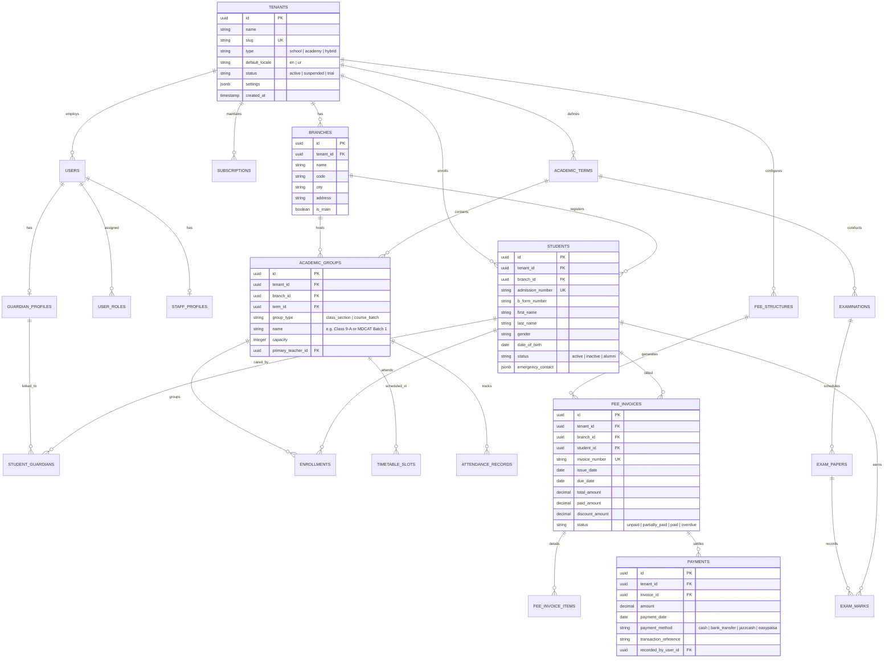
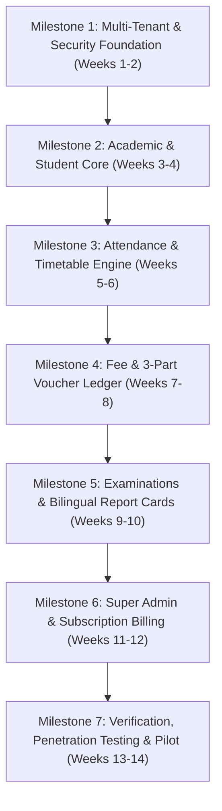

# Multi-Tenant School & Academy Management SaaS
## Comprehensive Product & Technical Blueprint
**Document Version:** 1.0.0  
**Target Architecture:** Multi-Tenant Modular Monolith (Laravel 11 / PostgreSQL 15 / Livewire 3 / Tailwind CSS)  
**Primary Market:** Pakistan (with International Multi-Currency & Multi-Calendar Architecture)  
**Classification:** Strategic Architectural Specification  

---

## 1. Product Vision & Market Positioning

### 1.1 Executive Summary & Problem Space
The private education sector in developing markets, particularly in Pakistan, is characterized by two distinct yet overlapping models:
1. **Formal K-12 Schools:** Ranging from community schools (150–500 students) to elite multi-branch networks (1,000–10,000+ students). They operate on annual academic cycles, rigid class/section hierarchies, uniform monthly tuition fees, and standardized examination schedules (Matric/FSc, Cambridge O/A-Levels, Federal Board).
2. **Tuition Academies & Test Preparation Centers:** Ranging from neighborhood coaching centers to specialized MDCAT/ECAT, CSS/PMS, and language institutes. They operate on rolling admissions, short-term intensive batches (2–6 months), course-based or installment-based fee structures, per-subject enrollment, and flexible instructor compensation models.

Existing market solutions suffer from critical flaws:
* **Legacy Single-Tenant Scripts:** Open-source or bloated legacy software (e.g., modified CodeIgniter/PHP 5.6 scripts) that require cumbersome dedicated hosting, break during updates, lack multi-tenancy, and provide poor security.
* **School-Centric Rigidity:** Traditional school software forces coaching academies into a rigid `Class -> Section` structure, making dynamic course batching, per-subject billing, and multi-month crash courses nearly impossible to manage cleanly.
* **Lack of True First-Class Urdu/RTL Support:** Urdu is treated as an afterthought with partial string translation, broken RTL layouts, and English-only fee vouchers/report cards.
* **Disconnection from Local Payment Realities:** Hardcoded Stripe-only billing in foreign SaaS tools fails in Pakistan, where fee collection is predominantly cash-over-counter via printed 3-part bank/cash vouchers, mobile wallets (JazzCash, Easypaisa, Raast), and manual bank transfers.

### 1.2 Value Proposition
**EduCore SaaS** is an enterprise-grade, multi-tenant education operating system designed to give institute proprietors complete operational control, prevent financial leakage, automate parent communication, and streamline academic operations through a single, beautifully localized platform.

```
+-----------------------------------------------------------------------------------+
|                               EDUCORE SAAS PLATFORM                               |
+-----------------------------------------------------------------------------------+
|                        SUPER ADMIN CONTROL PLANE                                  |
|  * Tenant Provisioning  * Subscription Engine  * Plan Enforcer  * Platform Analytics|
+-----------------------------------------------------------------------------------+
                                         |
     +-----------------------------------+-----------------------------------+
     |                                                                       |
     v                                                                       v
+----------------------------------------+   +----------------------------------------+
|         SCHOOL WORKSPACE               |   |        ACADEMY WORKSPACE               |
| * Academic Years / Sessions            |   | * Courses / Programs (Crash, Long)     |
| * Grades / Classes / Sections          |   | * Dynamic Batches & Cohorts            |
| * Annual Promotion Engine              |   | * Per-Subject / Installment Billing    |
| * Daily Morning Attendance             |   | * Slot & Subject-Wise Attendance       |
| * Matric/Cambridge Examination Cards   |   | * Certificate & Test-Prep Tracking     |
+----------------------------------------+   +----------------------------------------+
     |                                                                       |
     +-----------------------------------+-----------------------------------+
                                         |
+-----------------------------------------------------------------------------------+
|                            SHARED CORE FOUNDATION                                 |
| * RLS Tenant Isolation  * Bilingual Engine (EN/UR)  * Audit Ledger  * 3-Part Vouchers|
| * RBAC Engine          * Pakistani Phone/PKR Formats * Multi-Branch Hierarchy     |
+-----------------------------------------------------------------------------------+
```

### 1.3 Target Audience & Commercial Segmentation (Pakistan & Expansion)
* **Tier 1 (Neighborhood Schools & Private Academies):** 100–400 students. Value driver: Automated printed fee vouchers, defaulter tracking, basic SMS/WhatsApp alerts, eliminate manual register chaos.
* **Tier 2 (Mid-size Institutions & Multi-Branch Academies):** 400–1,500 students across 1–3 campuses. Value driver: Centralized financial ledger, multi-branch visibility, staff payroll, report cards.
* **Tier 3 (Large School Networks & Test-Prep Giants):** 1,500–10,000+ students. Value driver: Strict RBAC, custom domains, high-volume batch processing, branch-level profit/loss reporting, auditable financial logs.

---

## 2. School vs. Academy Workflow Comparison

Rather than building divergent codebases, EduCore leverages an **Abstract Academic Architecture (AAA)**. Below is the operational comparison that informs the unified domain design:

| Architectural Dimension | Formal K-12 School Model | Academy / Coaching Center Model | EduCore Unified Domain Abstraction |
| :--- | :--- | :--- | :--- |
| **Primary Cohort Grouping** | `Grade / Class` (e.g., Grade 9) + `Section` (e.g., Red) | `Course` (e.g., MDCAT Physics) + `Batch` (e.g., Evening Batch A) | `AcademicHierarchyNode` (Type: `ClassSection` vs `CourseBatch`) |
| **Academic Lifecyle** | Fixed 1-year cycle (e.g., April to March or Aug to May) | Rolling duration (4 weeks crash course to 6 months term) | `AcademicTerm` with start/end date, status flags, and flexible cadence |
| **Admission & Enrollment** | Full-time annual admission with permanent roll number | Rolling admissions; one student can enroll in 1 to 5 independent subjects/batches simultaneously | `Enrollment` model linking `Student` to one or more `AcademicGroup` instances |
| **Attendance Mechanism** | Once or twice daily roll call (Homeroom / Morning assembly) | Attendance per lecture / session slot or per subject | `AttendanceLog` with polymorphic target (`AcademicGroupSlot` vs `SectionDay`) |
| **Fee Structure** | Recurring monthly tuition + annual admission/charges | Fixed course fee, installment plans, or per-subject bundle fee | `FeeSchedule` supporting recurring monthly, one-time lump-sum, or custom installment milestones |
| **Examinations & Grading** | Midterms, Final terms, Term GPA, Division/Position ranks | Weekly chapter tests, mock exams, past paper simulations | `AssessmentPlan` supporting cumulative weighted term exams or independent mock test scorecards |
| **Academic Advancement** | End-of-year promotion engine (pass to next grade, retain) | Course completion, certification, exit without grade promotion | `CohortProgressionService` with rule-based promotion or certificate generation |
| **Parental Engagement** | High: Parent portal, guardian communication mandatory | Medium to Low: Older students self-manage; parents receive payment alerts | `GuardianLink` optionality toggle per institute configuration |

---

## 3. Complete Functional Requirements

### 3.1 Module A: Institute & Branch Management
* **Multi-Branch Hierarchy:** A Tenant represents the legal educational entity. Tenants can instantiate one or more `Branches` (Campuses).
* **Workspace Isolation Settings:** Each branch possesses isolated operational records (timetables, room allocations, branch-level cash registers) while rolling up to the tenant's consolidated financial reports.
* **Branding & Localization Customization:** Tenant-level logo, stamp, signature upload, primary/secondary brand colors, default interface language (EN or UR), calendar type (Gregorian default with Hijri overlay), and invoice receipt header/footer notes.

### 3.2 Module B: Student & Guardian Management
* **Student Identity:** System-generated unique Enrollment Number (format configurable per tenant: e.g., `LGS-2026-00421`) plus National ID / B-Form Number field with validation.
* **Guardian Relationship Network:** One guardian linked to multiple wards (siblings); multiple authorized guardians per ward (Father, Mother, Legal Guardian) with explicit billing and emergency contact flags.
* **Document Vault:** Secure encrypted storage for B-Form scans, previous school leaving certificates, medical allergy forms, and passport photos.
* **Student Lifecycle States:** `Inquiry` $\rightarrow$ `Applicant` $\rightarrow$ `Active` $\rightarrow$ `Suspended` $\rightarrow$ `Alumni` $\rightarrow$ `Transferred` $\rightarrow$ `Expelled`.

### 3.3 Module C: Academic Management (School & Academy Unified)
* **School Engine:** Configure Academic Sessions (e.g., 2026–2027), Classes (Playgroup to Grade 12 / O-Levels / A-Levels), Sections (capacity-managed), Subject mappings with mandatory vs elective designations.
* **Academy Engine:** Configure Programs (e.g., Entry Test Prep, FSc Evening Coaching, Spoken English), Courses, Batches with max capacity, start/end dates, instructor assignments, and room allocations.
* **Curriculum & Syllabus Allocation:** Syllabus topic breakdown, weekly teaching plans, and textbook references.

### 3.4 Module D: Teacher & Staff Management
* **Employee Profiles:** CNIC / National ID tracking, contract type (Permanent, Visiting, Hourly Lecturer), emergency contacts, educational degrees.
* **Department & Designation Matrix:** Configurable job titles (Principal, Section Head, Senior Subject Specialist, Lab Attendant, Peon).
* **Academic Workload Allocation:** Maximum weekly teaching hours, period allocations, subject specialization constraints.
* **Compensation Profiles:** Fixed monthly base salary, per-lecture payout rates (critical for tuition academies), and tax deduction preferences.

### 3.5 Module E: Attendance Management
* **Roster Modes:**
  1. *School Mode:* Fast grid-based morning homeroom attendance (Present, Absent, Late, Excused Leave).
  2. *Academy Mode:* Session/Batch-wise attendance marked by instructor or QR/Barcode desk scanner.
* **Correction & Audit Workflow:** Locked after midnight; adjustments require elevated permissions with audit log reasoning.
* **Automated Notification Hooks:** Triggers SMS/WhatsApp webhook dispatch when a student is marked `Absent` or `Late` after the grace cutoff window.

### 3.6 Module F: Fee & Financial Management (Auditable Double-Entry Ledger)
* **Fee Structure Architect:**
  * Component-based line items: Tuition Fee, Admission Fee, Computer Lab, Exam Fee, Sports Fee, Library Fund, Transport Fee.
  * Application rules: One-time, recurring monthly, quarterly, or installment milestone.
  * Concession & Scholarship Engine: Percentage-based or fixed discounts (e.g., Kinship/Sibling Concession, Need-Based Aid, Merit Scholarship) with expiry dates.
* **Voucher Generation & Billing Cycle:**
  * Automated batch generation on a user-defined day of the month (e.g., 1st of every month) with a due date and grace period.
  * Standard Pakistani **3-Copy Fee Challan** generation (Bank Copy, Institute Copy, Student Copy) in printable PDF with Barcode/QR Code for cashier scanning.
* **Payment Processing & Defaulters:**
  * Over-the-counter cash collection with partial payment support, automated late fine calculation (fixed amount per day or percentage).
  * Real-time ledger balance updating: `Invoice Generated` $\rightarrow$ `Partially Paid` $\rightarrow$ `Paid` $\rightarrow$ `Overdue / Defaulted`.
  * Printable stamped thermal receipt and formal A4/A5 bilingual receipt.

### 3.7 Module G: Examination, Assessment & Report Cards
* **Exam Setup:** Single-subject class tests, monthly assessments, centralized mid-term and final examinations.
* **Grading Schemes:** Flexible grading scales (Percentage, GPA 4.0, Letter Grades A+ to F, Pass/Fail thresholds).
* **Marks Entry & Validation:** Tabular fast marks entry with out-of-range validation and moderation locks.
* **Bilingual Report Card Generator:** Modern PDF report cards displaying marks breakdown, grade, class average, highest score, attendance summary, teacher comments, and principal signature block.

### 3.8 Module H: Timetable & Room Allocation
* **Scheduling Grid:** Days of the week (Monday to Saturday configuration for Pakistani market), customizable period lengths and break slots.
* **Conflict Detection Engine:** Real-time prevention of:
  * Teacher booked in two rooms simultaneously.
  * Room booked by two sections/batches simultaneously.
  * Section scheduled for two subjects at the same time.

### 3.9 Module I: Parent & Student Portal
* **Unified Guardian View:** Single login to monitor all enrolled children, even across different classes or branches.
* **Real-time Access:** Live attendance percentage, monthly fee status, downloadable PDF fee vouchers, exam result cards, homework assignments, and school circulars.
* **Academy Student Portal:** Self-service portal for adult/senior students to view batch schedules, download study materials, and review fee installments.

### 3.10 Module J: Communication & Notifications
* **Notice Board:** Categorized circulars (General, Emergency, Holiday, Exam Notice) with target audience filters (All, Specific Class, Teachers Only).
* **Multi-Channel Dispatcher:** System internal notifications + queued dispatchers for SMS gateways and WhatsApp Business API.

---

## 4. User Roles & Permissions Matrix

EduCore enforces a granular **Role-Based Access Control (RBAC)** architecture scoped strictly by Tenant and Branch.

```
+-------------------------------------------------------------------------------------------------------------------+
| System Entity       | Super Admin | Institute Owner | Branch Admin | Accountant | Teacher | Registrar | Parent/Student |
+---------------------+-------------+-----------------+--------------+------------+---------+-----------+----------------+
| Global Platform     |   CRUD      |      ---        |     ---      |    ---     |   ---   |    ---    |      ---       |
| Tenant Billing/Plan |   CRUD      |      Read       |     ---      |    ---     |   ---   |    ---    |      ---       |
| Institute Settings  |   Read      |      CRUD       |     Read     |    ---     |   ---   |    ---    |      ---       |
| Branch Management   |   Read      |      CRUD       |   Read/Edit  |    ---     |   ---   |    ---    |      ---       |
| Student Records     |   ---       |      CRUD       |     CRUD     |    Read    |  Read*  |   CRUD    |   Self-Only    |
| Academic Setup      |   ---       |      CRUD       |     CRUD     |    ---     |  Read   |   Read    |     Read       |
| Attendance Marking  |   ---       |      CRUD       |     CRUD     |    ---     |  CRUD*  |   CRUD    |   Self-Read    |
| Fee Structures      |   ---       |      CRUD       |   Read/Edit  |    CRUD    |   ---   |   Read    |      ---       |
| Voucher Collection  |   ---       |      CRUD       |     CRUD     |    CRUD    |   ---   |   Read    |   Self-Voucher |
| Exam Marks Entry    |   ---       |      CRUD       |     CRUD     |    ---     |  CRUD*  |   Read    |   Self-Results |
| Financial Audits    |   Read      |      CRUD       |   Branch-Only|    CRUD    |   ---   |    ---    |      ---       |
| Audit Log Viewer    |   Platform  |     Tenant      |    Branch    |    ---     |   ---   |    ---    |      ---       |
+-------------------------------------------------------------------------------------------------------------------+
* Scoped to assigned classes/batches only.
```

---

## 5. Module Architecture: Modular Monolith

To avoid premature microservice complexity while maintaining pristine domain boundaries, EduCore utilizes a **Modular Monolith** pattern in Laravel.

```
app/
├── Core/                         # Global SaaS Layer & Infrastructure
│   ├── Tenancy/                  # Tenant resolution, scoping, context switcher
│   ├── Billing/                  # Platform subscriptions, Stripe/JazzCash, quotas
│   └── Localization/             # Bilingual formatting, RTL helper, translation engine
└── Modules/                      # Independent Bounded Contexts
    ├── Institute/                # Tenants, Branches, Campuses, Settings
    ├── UserManagement/           # RBAC, Staff, Profiles, Auth
    ├── Student/                  # Inquiries, Admissions, Guardians, Profiles
    ├── Academic/                 # Classes, Sections, Courses, Batches, Subjects
    ├── Attendance/               # Student & Staff attendance, logs, alerts
    ├── Finance/                  # Fees, Vouchers, Invoices, Ledger, Payments
    ├── Examination/              # Exams, Papers, Grading Schemes, Report Cards
    ├── Timetable/                # Slots, Schedules, Room Allocations, Conflicts
    ├── Portal/                   # Guardian, Student, and Teacher dashboards
    └── Communication/            # Noticeboard, SMS, WhatsApp dispatchers
```

### Module Boundary Rules:
1. **Zero Cross-Module Direct DB Writes:** The `Attendance` module never writes directly to the `Finance` table. If late attendance triggers a fine, an internal Domain Event (`StudentExceededLateLimitEvent`) is published via Laravel's event dispatcher, and the `Finance` listener executes the fee ledger adjustment.
2. **Encapsulated Service Contracts:** Modules communicate via strongly-typed DTOs and Contract Interfaces.
3. **Dedicated View Components & Routes:** Each module registers its own route prefix, Livewire components, and policies.

---

## 6. Multi-Tenant Architecture: Trade-Off Analysis & Recommendation

### 6.1 Evaluation Matrix

| Strategy | Isolation Level | Infrastructure Cost | Migration Complexity | Backup & Restore | Operational Complexity | Recommendation Fit |
| :--- | :--- | :--- | :--- | :--- | :--- | :--- |
| **Strategy A: Shared Database with `tenant_id` + Row-Level Security (RLS)** | High (Cryptographically & DB Enforced) | **Lowest** (High tenant density on standard VPS/RDS) | Clean (Single migration run across all tenants) | Tenant export/import via SQL dump filters | Low (One connection pool, low memory footprint) | **RECOMMENDED FOR COMMERCIALLY VIABLE PRODUCTION** |
| **Strategy B: Separate Database per Tenant** | Absolute | **High** (Dozens/hundreds of DB connections, high RAM cost) | Very Complex (Running migrations across 500+ databases) | Trivial per tenant, nightmare globally | Very High (Connection pool exhaustion, maintenance overhead) | Not practical for price-sensitive educational SaaS |
| **Strategy C: Schema-per-tenant (PostgreSQL Schemas)** | High | Moderate | Moderate (Search-path switching, schema migration queues) | Moderate | Moderate (Schema proliferation limits in Postgres) | Viable alternative, but adds ORM caching friction |

### 6.2 Architectural Recommendation: Hybrid Scoped Shared Database
**We recommend and specify Strategy A (Shared Database with Multi-Layered Isolation):**
1. **Application-Level Global Scopes:** Every tenant-owned model implements a `BelongsToTenant` trait that automatically appends `WHERE tenant_id = current_tenant_id` to all queries via an Eloquent Global Scope.
2. **PostgreSQL Native Row-Level Security (RLS):** As an impenetrable defense-in-depth layer, the database user runs with RLS enabled on tenant tables. The application sets `SET LOCAL app.current_tenant_id = 'xxx'` per request session. Even if an engineer writes a raw un-scoped query, PostgreSQL blocks cross-tenant row leakage.
3. **Tenant Resolution Order:**
   * Custom Subdomain: `beaconhouse.educore.pk` $\rightarrow$ Tenant `UUID`.
   * Custom Domain: `portal.cityschool.edu.pk` $\rightarrow$ Domain resolver mapping.
   * Path/Session-based fallback for Super Admin impersonation: `app.educore.pk/tenant/{id}`.
4. **Zero-Trust Rule:** Never accept `tenant_id` from client payloads (`$_POST`, `$_GET`, JSON body). The `tenant_id` is stamped directly from the authenticated `TenantContext` singleton.

---

## 7. Database Schema & Entity-Relationship Design

### 7.1 Complete Mermaid Entity-Relationship Diagram



### 7.2 Polymorphic & Common Entity Normalization Strategy
To prevent code duplication:
* **`academic_groups`:** Replaces the need for duplicate `sections` and `batches` tables. The column `group_type` (`class_section` vs `course_batch`) dictates the frontend terminology and scheduling rules.
* **`enrollments`:** Maps any student to an `academic_group`. In school mode, a student has one active enrollment per term. In academy mode, a student holds multiple active enrollments across different batches.
* **Audit Trail Ledger (`audit_logs`):** Stores `actor_id`, `tenant_id`, `event_type`, `auditable_type`, `auditable_id`, `old_values` (JSONB), `new_values` (JSONB), `ip_address`, and `user_agent`.

---

## 8. SaaS Subscription & Monetization Engine

### 8.1 Plan Tiers & Metric Quotas

```
+-----------------------------------------------------------------------------------------+
| Feature / Quota Metric        | Starter Plan         | Professional Plan | Enterprise    |
+-------------------------------+----------------------+-------------------+---------------+
| Ideal Target                  | Small Academies/Sch. | Mid-Size Schools  | Large Chains  |
| Max Active Students           | Up to 250            | Up to 1,000       | Unlimited     |
| Max Campuses / Branches       | 1 Campus             | Up to 3 Campuses  | Unlimited     |
| Multi-Role Staff Accounts     | 10 Users             | 35 Users          | Unlimited     |
| Document Storage (B-Form, etc)| 5 GB                 | 25 GB             | 100 GB+       |
| 3-Part Bilingual PDF Vouchers | Included             | Included          | Included      |
| SMS / WhatsApp Notification API| Add-on Pay-as-you-go | Included Quota    | Custom Trunk  |
| Custom Domain Support         | No (Subdomain only)  | Yes               | Yes           |
| Monthly Price (PKR)           | PKR 7,500 / mo       | PKR 18,000 / mo   | PKR 45,000+   |
| Annual Discount               | 2 Months Free        | 2 Months Free     | Custom SLA    |
+-----------------------------------------------------------------------------------------+
```

### 8.2 Lifecycle & Grace Period Architecture
1. **Trial Period:** 14-day full feature access upon self-serve registration.
2. **Quota Enforcement Middleware:** `EnforceTenantQuotas` intercepts write actions (e.g., adding a student) and aborts with a graceful `QuotaExceededHttpException` when thresholds are hit.
3. **Grace Period & Dunning:**
   * Day 0: Invoice generated.
   * Day 1–7: Grace period; banner displays warning in Institute Admin.
   * Day 8: Read-only lock; staff can view and collect fees, but cannot enroll new students or modify exams.
   * Day 21: Full tenant suspension; landing redirects to renewal paywall.

### 8.3 Payment Gateway Adapter Pattern
* **Interface:** `PaymentGatewayInterface` with methods `generatePaymentIntent()`, `verifyWebhook()`, and `handleCallback()`.
* **Adapters:**
  * `ManualBankSlipAdapter`: Cashier uploads bank deposit slip; Super Admin verifies with one-click approval.
  * `1LinkPayproAdapter` / `JazzCashEasypaisaAdapter`: Instant online payment reconciliation via IPN webhooks.
  * `StripeAdapter`: For international tenants (USD/GBP/AED).

---

## 9. Bilingual & RTL Architecture

### 9.1 Technical RTL Strategy
EduCore supports simultaneous LTR and RTL rendering without duplicate CSS stylesheets:
* **Tailwind CSS Logical Properties:** Use `ms-` (margin-inline-start), `me-` (margin-inline-end), `ps-` (padding-inline-start), `pe-` (padding-inline-end), and `start-0` / `end-0` rather than `ml-`, `mr-`, `pl-`, `pr-`, `left-`, or `right-`.
* **Dynamic Document Direction:** The root HTML tag dynamically renders `<html lang="ur" dir="rtl">` based on `auth()->user()->preferred_locale ?? tenant()->default_locale`.
* **Font Strategy:**
  * English: Clean modern sans-serif (`Inter`, `Plus Jakarta Sans`).
  * Urdu Interface & Numbers: High-legibility Nastaliq/Naskh hybrid (`Noto Nastaliq Urdu` or `Jameel Noori Nastaleeq` web-font with proper kerning fallback).
* **Bilingual Translation Schema:** UI strings reside in structured JSON/PHP language files (`lang/en/app.php`, `lang/ur/app.php`). Database-backed dynamic content (e.g., Subject names, Noticeboard titles) utilizes a JSONB structure: `{"en": "Physics", "ur": "طبیعیات"}`.

### 9.2 Bilingual Document Generation (PDF Engine)
* **Problem:** Standard Dompdf struggles with complex Urdu Harakat and ligature reshaping.
* **Engine Specification:** Use a headless Chromium rendering pipeline (via Laravel Browsershot / Puppeteer) or configured mPDF with UTF-8 bidirectional shaping algorithms enabled. This ensures that 3-part bank vouchers and report cards render crisp, professional Urdu typography alongside English legal text.

---

## 10. Navigation & Information Architecture

### 10.1 Super Admin Navigation (SaaS Management)
* **Dashboard:** Real-time MRR, Active vs Suspended Tenants, Student Enrollment Volume, System Health.
* **Tenant Directory:** All Institutes, Onboarding Requests, Tenant Impersonation button, Domain Mappings.
* **Subscriptions & Billing:** Active Subscriptions, Pending Bank Slip Approvals, Invoices, Discount Codes.
* **Package Plans:** Plan Limits, Feature Flag Configurations, Pricing matrix.
* **Audit & Security:** Cross-Tenant Activity Logs, Failed Authentication attempts, System Exceptions.

### 10.2 Institute Admin Navigation (School View vs Academy View)

```
+------------------------------------+   +------------------------------------+
|         SCHOOL ADMIN SIDEBAR       |   |        ACADEMY ADMIN SIDEBAR       |
+------------------------------------+   +------------------------------------+
| [Dashboard] Overview & Metrics     |   | [Dashboard] Overview & Metrics     |
| [Academics]                        |   | [Courses & Batches]                |
|   ├── Academic Sessions            |   |   ├── Programs & Courses           |
|   ├── Classes & Sections           |   |   ├── Active Batches               |
|   └── Subject Allocation           |   |   └── Room & Slot Timetables       |
| [Students]                         |   | [Students]                         |
|   ├── Admissions & Inquiries       |   |   ├── Rolling Registrations        |
|   ├── Student Directory            |   |   ├── Course Enrollments           |
|   └── Promotion Engine             |   |   └── Completion & Certificates    |
| [Staff & Teachers] Directory & Work|   | [Faculty & Instructors] Scheduling |
| [Daily Attendance] Grid & Reports  |   | [Batch Attendance] Slot-wise Log   |
| [Fee & Accounts]                   |   | [Fee & Accounts]                   |
|   ├── Fee Structures & Discounts   |   |   ├── Course Fee Installments      |
|   ├── 3-Part Challan Generator     |   |   ├── Voucher Generator & Receipts |
|   ├── Cashier Over-Counter Pay     |   |   ├── Cashier Over-Counter Pay     |
|   └── Defaulter Tracking Ledger    |   |   └── Defaulter Tracking Ledger    |
| [Examinations] Mid/Final & Cards   |   | [Tests & Assessments] Mock Tests   |
| [Communication] Circulars & SMS    |   | [Communication] WhatsApp / SMS     |
| [Settings] Campus & Customization  |   | [Settings] Campus & Customization  |
+------------------------------------+   +------------------------------------+
```

---

## 11. Parent & Student Portal Structure

* **Authentication:** Lightweight mobile-first login using Mobile Phone + Password or National ID (B-Form/CNIC) + OTP.
* **Guardian Multi-Ward Switcher:** A single mother logging in can toggle effortlessly between her son in Grade 4 and her daughter in Grade 9 without relogging.
* **Financial Ledger Screen:** Clear display of current month's fee, due date, outstanding arrears, one-click PDF fee voucher download, and historical paid receipts.
* **Attendance Calendar:** Interactive monthly heatmap showing Present (Green), Late (Yellow), Absent (Red), and Holiday (Blue).
* **Digital Result Card:** Interactive term breakdown with subject grades, teacher remarks, and printable PDF report card download.

---

## 12. Technical Architecture & Tech Stack

```
+-----------------------------------------------------------------------------------+
|                        FRONTEND PRESENTATION LAYER                                |
|   Blade Templates  +  Livewire 3 (Dynamic Reactivity)  +  Alpine.js (Micro-UI)     |
|   Tailwind CSS (JIT, RTL-first with logical utilities)                            |
+-----------------------------------------------------------------------------------+
                                         |
                                         v
+-----------------------------------------------------------------------------------+
|                      APPLICATION / CONTROLLER / ACTION LAYER                      |
|   Form Requests (Validation)  -->  Action Classes (Single Responsibility)         |
|   Eloquent Models with Global Tenant Scopes  +  PostgreSQL Row-Level Security     |
+-----------------------------------------------------------------------------------+
                                         |
                                         v
+-----------------------------------------------------------------------------------+
|                         BACKGROUND ASYNCHRONOUS LAYER                             |
|   Redis Queues  -->  Voucher PDF Generation, SMS/WhatsApp Webhooks, Daily Audit   |
+-----------------------------------------------------------------------------------+
                                         |
                                         v
+-----------------------------------------------------------------------------------+
|                            DATABASE & STORAGE LAYER                               |
|   PostgreSQL 15 (Relational Data, JSONB Metadata, RLS, Indexes)                   |
|   Local Disk (Dev) / Cloud S3-compatible Object Storage (Encrypted Vault)         |
+-----------------------------------------------------------------------------------+
```

### Key Technical Decisions:
1. **PHP 8.3/8.4 + Laravel 11.x:** Utilizes typed class constants, readonly classes, and streamlined directory structures.
2. **Livewire 3 + Alpine.js:** Eliminates the latency, duplicate validation, and API serialization burden of decoupled SPA frameworks (React/Vue) while delivering single-page application speed for tables, modals, and dynamic fee forms.
3. **Database Engine: PostgreSQL 15:** Superior JSONB querying, native Row-Level Security, and bulletproof transactional integrity for financial ledgers.

---

## 13. Security Architecture & Threat Modeling

* **Cross-Tenant Data Leakage Prevention:** Enforced at two independent tiers:
  1. *Tier 1 (Application):* Eloquent Global Scope validates `tenant_id` on every query.
  2. *Tier 2 (Database):* PostgreSQL Row-Level Security policy refuses query execution if `app.current_tenant_id` does not match row ownership.
* **Financial Immutability:** Fee invoices and payment records are never hard-deleted. Corrections are issued via reverse credit memos with audit references.
* **File Upload Sanitization:** Strict MIME-type validation, random UUID file re-naming, and private, non-public storage with signed temporary download URLs for student documents.
* **Rate Limiting:** Granular throttling on sensitive endpoints (e.g., student inquiry forms, login attempts, voucher regeneration).

---

## 14. API Strategy & Mobile Readiness

EduCore is architected as an API-First backend:
* **Authentication:** Laravel Sanctum issuing revocable Bearer tokens.
* **API Versioning:** Clean `/api/v1/tenant/...` routes mirroring the action classes used by Livewire.
* **Biometric Device Integration:** Lightweight HTTP sync endpoint allowing on-premise biometric attendance machines (e.g., ZKTeco) to push punch logs via scheduled cron worker.
* **Future Mobile Apps:** Dedicated lightweight endpoints for Flutter/React Native parent and student apps.

---

## 15. MVP Scope & Commercial Release Strategy

### 15.1 MVP Strict Boundary (Commercial Pilot - Phase 1)

```
+-----------------------------------------------------------------------------------------+
| INCLUDED IN MVP (PHASE 1)                      | DEFERRED TO POST-MVP (PHASE 2 & 3)     |
+------------------------------------------------+----------------------------------------+
| * Multi-Tenant Core + Subdomain Resolution     | * Biometric Device Hardware Sync Agent |
| * Super Admin Platform Management & Billing    | * Online Payment Gateways (1Link/Jazz) |
| * Tenant Onboarding & Institute Configurator   | * Transport Route & Vehicle Tracking   |
| * Branch & Academic Setup (School + Academy)   | * Hostel & Room Management             |
| * Student & Guardian Profiles + Unique IDs     | * Library Barcode Management           |
| * Class/Section & Course/Batch Allocation      | * Full Staff Payroll & Tax Deduction   |
| * Daily & Batch-wise Attendance                | * Native iOS / Android Mobile Apps     |
| * Fee Structure & 3-Part Voucher PDF Engine    | * AI-Powered Exam Performance Predictor|
| * Over-the-Counter Cashier Payment Collection  | * WhatsApp Business Cloud API Direct   |
| * Basic Exam Setup, Marks Entry & Report Cards | * Multi-Currency Forex Engine          |
| * English + Urdu Full RTL Interface Support    | * Custom Drag-and-Drop Form Builder    |
+------------------------------------------------+----------------------------------------+
```

---

## 16. Future Roadmap

* **Release 2.0 (FinTech & Automation):** Direct integration with Pakistani FinTechs (PayMob, 1Link 1Bill, JazzCash, Easypaisa) for instant QR code mobile voucher settlement. Automated WhatsApp notification bot for attendance and fee reminders.
* **Release 3.0 (Campus Operations):** School bus GPS tracking module with parent proximity alerts; library book checkout system; inventory asset tracker.
* **Release 4.0 (AI Academic Copilot):** AI-generated personalized student progress remarks; predictive student churn/dropout risk analytics; automated timetable optimization via constraint satisfaction algorithms.

---

## 17. Development Phases & Implementation Timeline



---

## 18. Major Technical Risks & Mitigation Strategies

1. **Urdu Ligature & Font Distortion in PDF Vouchers:**
   * *Risk:* Dompdf distorts Nastaliq fonts and breaks RTL right-alignments.
   * *Mitigation:* Implement standard Naskh typography for tabular numbers and headings; use Browsershot or tested mPDF bidi engines with embedded font subsets.
2. **High-Volume Monthly Fee Generation Deadlocks:**
   * *Risk:* A school with 5,000 students generating monthly invoices triggers database lock contention.
   * *Mitigation:* Chunk invoice generation via queued background jobs (`Queue::bulk`) running in isolated transactions per 100 students.
3. **Cross-Tenant Leaks through Cached Data:**
   * *Risk:* Redis or application memory caching leaking student search results between institutes.
   * *Mitigation:* Prefix all cache keys strictly with `tenant_{id}:{module}:{key}`.
4. **Environment PHP Version Mismatch:**
   * *Risk:* System CLI running PHP 7.3 while modern Laravel requires PHP 8.2+.
   * *Mitigation:* Align environment to Laragon's installed PHP 8.3 (`C:\laragon\bin\php\php-8.3.15-Win32-vs16-x64\php.exe`).

---

## 19. Comprehensive Testing Strategy

* **Unit Testing:** Financial calculation formulas, late fee compounding, concession applications, and attendance rate percentages.
* **Cross-Tenant Isolation Tests (Pest/PHPUnit):** Automated test suite that logs in as Tenant A and explicitly attempts to query, mutate, or delete records belonging to Tenant B; verifies that a 404 or ModelNotFoundException is strictly returned.
* **Browser Tests (Laravel Dusk):** Automated testing of English LTR $\leftrightarrow$ Urdu RTL switcher, verifying form layout integrity and modal dialog accessibility.
* **Financial Reconciliation Audits:** Invariant test confirming: $\sum (\text{Item Amounts}) - \text{Discounts} + \text{Fines} = \text{Total Invoice Amount}$.

---

## 20. Estimated Development Complexity & Resource Sizing

* **Total Estimated Architecture Effort:** 14 Calendar Weeks (1 Lead Full-Stack Architect / Senior Laravel Engineer).
* **Story Points Breakdown:**
  * Foundations & Tenancy: 21 SP
  * Academic & Student Management: 28 SP
  * Financial Engine & PDF Vouchers: 34 SP
  * Attendance & Timetable: 21 SP
  * Exams & Assessment: 21 SP
  * Localization & RTL UI: 18 SP
  * Super Admin & Monetization: 21 SP
  * Testing, Security Audits & Hardening: 25 SP
* **Total Project Scope:** ~189 Story Points.
