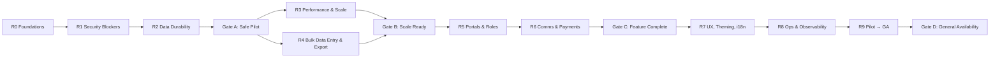

# EduCore SMS — Master Roadmap (Pilot → GA → Scale)

**Version:** 1.0.0  
**Created:** 2026-11-19  
**Status:** Active — this is the single source of truth for "what to do next".  
**Owner:** Product owner (Owais) decides; the engineering agent executes in the order below.

> **How to use this document:** The agent always works on the **first unchecked task** in the lowest-numbered open phase. It does not ask "what next?". It stops only at a **Gate** (section 6), at a **Decision Needed** item with no default (section 8), or when a task fails verification. Progress is tracked in section 11.

---

## 1. Purpose & Principles

EduCore is a multi-tenant School + Academy management SaaS for the Pakistani market (Laravel 13, Livewire 4, PostgreSQL with RLS, shared-schema tenancy).

**Non-negotiables (apply to every task):**
1. **Tenant isolation is never weakened.** Every new table gets `tenant_id`, RLS, and a cross-tenant regression test.
2. **Fail closed.** Authorization defaults to deny; server-side checks, never UI-only.
3. **No claim without evidence.** A task is Done only when tests ran and results are recorded. Browser/visual items are marked *Tested*, *Blocked*, or *Code-inspected* — never blurred.
4. **Smallest safe change.** No redesign of working modules; no unrelated edits.
5. **No secrets in repo.** No default credentials, no `.env` edits by the agent without an approved change list.
6. **Reversible and observable.** Migrations are additive/non-destructive; every background process has logs and a failure path.
7. **No commit/push/merge/deploy** unless the owner explicitly asks.

---

## 2. Verified Baseline (as of 2026-11-19)

Facts confirmed by inspecting code/DB in this repository:

| Area | Verified state |
| :--- | :--- |
| Automated tests | 180 passed, 1,399 assertions (`php artisan test`) |
| Stack | PHP ^8.3, Laravel ^13.17, Livewire ^4.4, Sanctum ^4.3 (unused), spatie/laravel-permission ^8.5 |
| DB | PostgreSQL; 81 public tables, **64 with RLS enabled** (17 tables without RLS — need classification) |
| Runtime drivers | `CACHE_STORE=database`, `QUEUE_CONNECTION=database`, `SESSION_DRIVER=database`, `FILESYSTEM_DISK=local`, `MAIL_MAILER=log` |
| RBAC | 22 permissions; seeded roles in the dev DB: `super_admin`, `institute_owner` (other role set per tenant not yet verified) |
| Tenant context | `PostgresTenantContext::set()` uses `set_config('app.current_tenant_id', ?, isLocal)`; the HTTP middleware passes `isLocal: false` (session-level) |
| Auth hardening | **No rate limiting/throttle** found; no security headers (CSP/HSTS/X-Frame-Options); no 2FA |
| Seeder | `RoleAndPermissionSeeder` creates super admin with a hardcoded password |
| Backups / scheduler | None. No backup tooling; `routes/console.php` has no scheduled tasks |
| Import/Export | No bulk import. CSV/export signals in ledger, attendance analytics, tabulation (not browser-verified) |
| Portals | No parent/student/teacher portal. No `routes/api.php` |
| Query patterns | ~97 `->get()` vs 2 `paginate()` in `app/Modules` |
| Storage | Student documents use `Storage::disk('local')` |
| Indexes | ~164 index/unique definitions across migrations; 0 partitioning |
| Localization | Navigation + 6 Batch-3 modules + landing pages translated (`lang/en|ur/sms.php`); earlier-phase views and validation messages still English |
| Theming | Layout hardcodes indigo + EduCore logo; no dark mode; no per-tenant branding applied |
| Browser acceptance | **Never executed** (Chrome DevTools could not attach). Backend/Livewire verified only |

**Open items carried from earlier batches:** (a) live browser acceptance MT-01…MT-23 (`doc/sms_manual_testing_checklist.md`); (b) A4/80mm PDF visual inspection with real sample records; (c) translate remaining views + validation strings; (d) classify the 17 non-RLS tables; (e) verify per-tenant role list actually provisioned.

---

## 3. Capacity Targets & SLOs (to be measured, not assumed)

No load test exists yet. These are **targets** that Phase R3 must prove or revise.

| Metric | Target at Gate B |
| :--- | :--- |
| Concurrent active users per app node | 150 (mixed read/write) |
| p95 server time, list/detail pages | < 400 ms |
| p95 server time, writes (admission, payment) | < 600 ms |
| Cashier payment post | < 800 ms p95, zero double-posting under retries |
| Monthly voucher batch (500 invoices) | completes < 3 min via queue, idempotent |
| PDF single voucher | < 3 s; batch via queue, never inside a web request |
| Tenants per single-DB cluster (initial) | 150–300 small tenants (300–1,500 students each) |
| Error rate under test load | < 0.5 % |
| RPO / RTO (production) | RPO ≤ 15 min (WAL/PITR), RTO ≤ 2 h |

Scale tiers (re-evaluate with measurements): **Tier 1** single node + Postgres; **Tier 2** + Redis, queue workers, PgBouncer, object storage; **Tier 3** + read replica, partitioning of high-volume tables, horizontal app nodes.

---

## 4. Phase Overview & Dependencies

| Phase | Theme | Rough effort* | Exit gate |
| :--- | :--- | :--- | :--- |
| R0 | Foundations & safety net | 2–4 days | — |
| R1 | Security blockers | 4–7 days | — |
| R2 | Data durability (backup/export/storage) | 4–7 days | **Gate A** |
| R3 | Performance & scalability | 7–12 days | — |
| R4 | Bulk data entry & export | 6–10 days | **Gate B** |
| R5 | Portals & role matrix | 12–20 days | — |
| R6 | Communications & payments | 10–18 days | **Gate C** |
| R7 | UX, theming, full Urdu, accessibility | 8–14 days | — |
| R8 | Ops, observability, release engineering | 6–10 days | — |
| R9 | Real pilot → GA | 3–6 weeks calendar | **Gate D** |

\*Rough single-developer-with-AI estimates; they will be re-baselined after R0. R3 and R4 may run in parallel after Gate A.

---

## 5. Task Catalogue

Each task: **ID — title**, deliverable, acceptance criteria (AC). All tasks also need: tests added/updated, full suite green, tracker updated, short note appended to `doc/roadmap_changelog.md`.

### R0 — Foundations & Safety Net
- **R0.1 Working-tree reconciliation.** Produce a list of all uncommitted changes grouped by batch (1, 2, 3, 3.1, 4.1, landing). *AC:* grouped change inventory in changelog; owner decides commit strategy (Decision D1). Agent does not commit.
- **R0.2 CI pipeline.** GitHub Actions (or equivalent): composer install, Postgres service, migrate, `php artisan test`, Laravel Pint, static analysis (Larastan level 5+), `composer audit`. *AC:* pipeline definition committed to repo files; local dry-run command documented.
- **R0.3 Test/DB hygiene.** Confirm the test DB (`educore_saas_testing`) is isolated from dev data; document the app-role vs migrator-role setup. *AC:* `doc/environment_setup.md` with exact commands.
- **R0.4 Config hygiene.** `.env.example` complete and production-safe defaults documented (`APP_DEBUG=false`, secure cookies). *AC:* checklist in `doc/production_config_checklist.md`.
- **R0.5 Seeder hardening.** Remove hardcoded super-admin password; create the super admin from env vars or an interactive artisan command. *AC:* no password literal in `database/seeders`; pilot seeding documented; tests updated.

### R1 — Security Blockers
- **R1.1 Auth throttling & lockout.** Rate-limit login (per email+IP), password reset, and sensitive Livewire actions; temporary lockout with audit entry. *AC:* tests prove 429 after N failures; legitimate login unaffected.
- **R1.2 Security headers middleware.** CSP (report-only first, then enforce), HSTS (prod), X-Frame-Options/frame-ancestors, X-Content-Type-Options, Referrer-Policy, Permissions-Policy. *AC:* header tests; Livewire + Vite assets still work.
- **R1.3 Tenant-context pool safety.** Move HTTP tenant context to transaction-scoped (`SET LOCAL`) or a documented safe equivalent; verify behavior behind PgBouncer **transaction** pooling; ensure queue jobs and artisan commands reset context. *AC:* concurrency test shows no context leak across interleaved tenants; ADR written.
- **R1.4 RLS coverage audit.** Classify the 17 tables without RLS (global vs tenant data); add RLS where tenant data exists; add a schema-wide test that fails when a new table with `tenant_id` lacks RLS. *AC:* classification table in docs; guard test in CI.
- **R1.5 Session & cookie hardening.** Secure/HttpOnly/SameSite, session regeneration on login, idle timeout, "log out other devices". *AC:* tests + config checklist.
- **R1.6 Password & account policy.** Minimum strength, breached-password check option, forced change on first login for provisioned staff. *AC:* tests.
- **R1.7 2FA (TOTP) for Super Admin and Institute Owner.** Optional for other roles (flag). Recovery codes. *AC:* enrollment, login, recovery tested.
- **R1.8 Audit log coverage.** Tenant-level audit trail for: login/logout, role changes, staff suspend, refunds/approvals, document access/delete, data export, settings changes. *AC:* immutable-ish table with RLS, viewer for owner, retention policy.
- **R1.9 Upload & file security.** Private disk, signed temporary URLs for download, MIME sniffing, size limits, optional AV scan hook, filename sanitation (extends Batch 3.1). *AC:* cross-tenant download test.
- **R1.10 Dependency & secret scanning.** `composer audit` + `npm audit` in CI; secret scanning rule. *AC:* CI fails on high severity.
- **R1.11 Least-privilege DB roles review.** Confirm runtime role is non-superuser, no BYPASSRLS, migrator separate; document grants. *AC:* automated check script.

### R2 — Data Durability  *(ends with Gate A)*
- **R2.1 Scheduler baseline.** Define `routes/console.php` schedule (cleanup, voucher reminders hooks, trial expiry, backup verification) with `withoutOverlapping`/`onOneServer`. *AC:* `schedule:list` documented; tests for command idempotency.
- **R2.2 Database backups.** Logical backup (`pg_dump`) nightly + WAL archiving / PITR strategy (pgBackRest, WAL-G, or managed service per Decision D3); encryption at rest of backup artifacts; retention policy. *AC:* runbook + scripts; backup success/failure alerts.
- **R2.3 Restore drill.** Restore into an isolated DB and run a verification query set. *AC:* drill report with measured RTO.
- **R2.4 Per-tenant export.** Owner-triggered, queued export of all tenant data (CSV/JSON zip + documents manifest), audited, rate-limited, signed download. *AC:* export contains only that tenant; tested for isolation.
- **R2.5 Object storage for documents.** S3-compatible disk (Decision D2), tenant-prefixed keys, lifecycle + backup of documents. *AC:* local→S3 migration command, rollback plan.
- **R2.6 Tenant offboarding & retention.** Suspend → export → soft-delete → scheduled hard-delete with legal hold flag. *AC:* tested lifecycle; no orphan rows.
- **R2.7 Browser acceptance round 1.** Execute MT-01…MT-23 in a real browser (Decision D6 covers tooling). *AC:* report with screenshots; defects fixed or ticketed.

> **Gate A — Safe Pilot:** R0–R2 done, R1.3/R1.4 verified, backups restored in a drill, browser round 1 complete. Only then onboard a friendly pilot school with real data.

### R3 — Performance & Scalability
- **R3.1 Redis adoption.** Cache, queue, session on Redis; Laravel Horizon for queues; failure/retry/dead-letter policy. *AC:* config + tests; queue monitor.
- **R3.2 Query audit.** Replace unbounded `->get()` in list/report paths with pagination/chunking/cursors; enable `Model::preventLazyLoading()` in non-production to find N+1. *AC:* audit table of all 97 sites (fixed/justified); N+1 tests on top 10 pages.
- **R3.3 Index & plan review.** Generate synthetic data (see R3.6), run `EXPLAIN (ANALYZE, BUFFERS)` on the top 30 queries, add/adjust composite indexes (always leading with `tenant_id`). *AC:* before/after timings recorded.
- **R3.4 Caching strategy.** Cache tenant resolution, permission lookups, plan/quota reads, static reference data with tenant-scoped keys and explicit invalidation. *AC:* tests prove no cross-tenant cache bleed.
- **R3.5 Heavy work off the request path.** PDF batch, voucher generation, exports, notifications via queues; Browsershot concurrency limits and timeouts. *AC:* no request > 10 s in test scenarios.
- **R3.6 Synthetic data generator.** Artisan command to create N tenants × M students with attendance, invoices, ledger lines (never run against production). *AC:* deterministic seed, documented sizes.
- **R3.7 Load & soak tests (k6).** Scenarios: morning attendance burst, fee-collection day (cashier POS), month-start voucher generation, report browsing. *AC:* results versus section 3 targets; bottleneck report; revised targets.
- **R3.8 PgBouncer + Postgres tuning.** Pooling mode compatible with R1.3, `statement_timeout`, `lock_timeout`, `idle_in_transaction_session_timeout`, `pg_stat_statements`. *AC:* config docs + verification test.
- **R3.9 High-volume table plan.** Decide and (if thresholds hit) implement partitioning/archival for attendance and journal lines (ADR with thresholds, e.g. > 50M rows/table). *AC:* ADR + migration prototype in isolated DB.

### R4 — Bulk Data Entry & Export  *(ends with Gate B together with R3)*
- **R4.1 Import framework.** Generic pipeline: upload → parse (CSV/XLSX) → map columns → **validate with dry-run preview** → queued commit → downloadable error report. Idempotent (natural-key upsert), transactional per chunk, quota-aware, tenant-bound, audited. *AC:* framework tests with malformed files, duplicates, huge files, cross-tenant keys.
- **R4.2 Student + guardian import** (with sibling linking by CNIC blind index, class/section placement, admission-number rules). Template download in English and Urdu headers.
- **R4.3 Staff import** (role assignment honors privilege-escalation rules from Batch 3.1; quota enforced).
- **R4.4 Fee structure & opening balance import** (balanced GL entries only).
- **R4.5 Attendance bulk tools** (bulk mark, CSV upload for backfill with lock rules).
- **R4.6 Bulk actions** (bulk promote, bulk voucher generation preview, bulk SMS targeting list).
- **R4.7 Streaming exports** (students, fees/defaulters, attendance, ledger, results) with filters, memory-safe cursors, audit entries, permission-gated.
- **R4.8 Import/export browser acceptance.**

> **Gate B — Scale Ready:** load tests meet (or have documented, accepted deviations from) section 3 targets; import/export verified; PgBouncer-safe context proven.

### R5 — Portals & Role Matrix
- **R5.1 Role & permission matrix design.** Document and implement default role templates per tenant: Institute Owner, Principal/Admin, Accountant, Cashier, Teacher, Front Desk, (optional) Librarian. Permission-to-route/action matrix with tests per role (positive and negative). *AC:* matrix doc + role-based test suite.
- **R5.2 Guardian/Student identity model.** Decision D4 (phone-OTP vs email/password vs invite link). Separate authentication guard or role with strict scoping; account provisioning from existing guardian records; link-to-children policy. *AC:* ADR + tests proving a guardian can never see unlinked students or other tenants.
- **R5.3 Parent portal (read-first).** Children switcher, fee vouchers + payment status + download, attendance summary/calendar, results & report cards, leave application, notices. Mobile-first, bilingual.
- **R5.4 Student portal (read-only).** Timetable, attendance, results, fee status.
- **R5.5 Teacher portal.** My timetable, mark attendance, enter marks, substitution notices, leave requests.
- **R5.6 Announcements & notice board** (tenant-wide, class-targeted, bilingual, audit).
- **R5.7 Portal security & privacy.** Throttling, IDOR tests for every portal route, PII masking defaults, consent/ToS acceptance, session lifetime.
- **R5.8 Portal browser acceptance** including 375px mobile and Urdu RTL.

### R6 — Communications & Payments
- **R6.1 Notification abstraction.** Channel interface (SMS, WhatsApp, email, in-app) with provider adapters, per-tenant sender settings, Urdu templates, opt-out, delivery receipts, retries, cost counters. Builds on existing absentee-notification outbox.
- **R6.2 Provider integration(s)** per Decision D5 (SMS/WhatsApp). Sandbox tests + contract tests with fakes.
- **R6.3 Payment adapters.** 1Bill/PSID, JazzCash, Easypaisa (per Decision D5): payment initiation, webhooks with signature verification and idempotency, reconciliation job, mismatch queue. *AC:* replay/duplicate webhook tests; GL stays balanced.
- **R6.4 Fee reminders & dunning** (scheduled, quiet hours, defaulter lists).
- **R6.5 SaaS subscription automation.** Trial expiry, grace, past-due, suspension via scheduler; invoices for tenants; quota overage handling; email notices. *AC:* lifecycle tests with time travel.
- **R6.6 Email deliverability** (SMTP/provider, SPF/DKIM docs, templates bilingual).

> **Gate C — Feature Complete:** portals live behind feature flags, notifications and at least one payment rail verified in sandbox, role matrix tests green.

### R7 — UX, Theming, Localization, Accessibility
- **R7.1 Design tokens & theming.** CSS variables; tenant branding (logo, primary colour) applied in layout, vouchers, report cards; dark mode toggle (persisted); contrast validation. *AC:* theme tests; vouchers still print correctly.
- **R7.2 Complete Urdu localization.** All remaining views, validation messages (`lang/ur/validation.php`), flash messages from Livewire components, emails, PDF templates; lint test that fails on hardcoded user-facing strings in Blade (allowlist for DB values).
- **R7.3 RTL polish.** Mixed Urdu/English alignment, number formatting policy (Latin vs Eastern Arabic digits per tenant), Nastaliq line-height and clipping review, font self-hosting (avoid runtime Google Fonts dependency/privacy and offline issues).
- **R7.4 Responsive hardening.** Tables → card layouts at ≤ 640px where needed, modal sizing, touch targets ≥ 44px, no horizontal overflow at 375px.
- **R7.5 Accessibility (WCAG 2.1 AA).** Keyboard paths, focus traps for modals/drawer, ARIA live regions for Livewire flashes, colour contrast; automated axe scan in CI.
- **R7.6 UX polish.** Global search, empty states, loading/skeleton states, confirm dialogs for destructive actions, onboarding checklist for new tenants, in-app help links.
- **R7.7 Browser acceptance round 2** (desktop, tablet, mobile; EN/UR).

### R8 — Operations, Observability & Release Engineering
- **R8.1 Error tracking & logging.** Sentry (or equivalent), structured JSON logs with `tenant_id`/request id (no PII), log retention.
- **R8.2 Health & metrics.** `/health` (DB, Redis, queue, disk), uptime monitor, Prometheus/managed metrics, dashboards: latency, errors, queue depth, DB connections, slow queries.
- **R8.3 Alerting & on-call.** Alert rules and a basic runbook for the top failure modes.
- **R8.4 Environments & deploy.** Staging mirrors production; zero-downtime deploy procedure; migration safety policy (expand/contract, no destructive migrations in deploy); rollback procedure. Decision D3 (hosting).
- **R8.5 Security review.** Independent pass: OWASP ASVS L2 checklist, pen-test of tenant isolation and portals, fix findings.
- **R8.6 DR drill & backup monitoring** (repeat R2.3 against production-like infra).
- **R8.7 Legal & compliance docs.** Privacy policy, ToS, data-processing terms, data-retention policy, minors' data handling (guardian consent), alignment with applicable Pakistani data-protection requirements (needs legal review — not legal advice).
- **R8.8 Support tooling.** Super-admin impersonation with audit (exists; verify), tenant health view, usage metrics, announcement banner.

### R9 — Pilot → General Availability
- **R9.1 Pilot onboarding** of 1–3 friendly schools/academies using real (consented) data via the import tools.
- **R9.2 UAT scripts & sign-off** per role (owner, accountant, cashier, teacher, parent).
- **R9.3 Weekly feedback loop** → triaged backlog; severity SLA (S1 24h, S2 3d).
- **R9.4 Data correctness reviews** (fee totals, GL balance, attendance counts vs school's own records).
- **R9.5 Pricing & packaging validation** against measured cost per tenant.
- **R9.6 GA checklist** and launch plan.

> **Gate D — General Availability:** security review closed, DR drill passed, pilot sign-off, monitoring + support process live, legal docs approved.

---

## 6. Gates (Hard Stops)

| Gate | Must be true | Evidence required |
| :--- | :--- | :--- |
| **A — Safe Pilot** | R0–R2 complete; no default credentials; throttling + headers; context pool-safe; RLS coverage guard; backup + restore drill; browser round 1 | Test report, drill report, screenshots |
| **B — Scale Ready** | R3 + R4 complete; load test report meets/adjusts targets with owner approval | k6 reports, EXPLAIN notes, import samples |
| **C — Feature Complete** | R5 + R6 complete; IDOR tests for portals; sandbox payments/SMS verified | Test report, sandbox logs |
| **D — GA** | R7–R9 complete; independent security review closed; DR drill; pilot UAT sign-off | Reviews, sign-offs |

At each gate the agent writes `doc/gate_<letter>_report.md` (what was verified, what was not, residual risks) and **stops for owner review**. Between gates it continues automatically.

---

## 7. Per-Task Execution Protocol (for the agent)

1. Read the task, the relevant code, and existing tests (inspect before editing).
2. Check the **Decision Log** (section 8); if a decision has a default, use it and note it; if it is blocking with no default, stop and ask once with concrete options.
3. Implement the smallest complete change; follow existing module architecture (`app/Modules/*`, services, Livewire, policies).
4. Add tests: happy path, authorization negatives, tenant-isolation negative, edge cases.
5. Run focused tests, then the **full suite**; report exact counts. Never claim a pass that was not run.
6. Update: tracker (section 11), `doc/roadmap_changelog.md` (date, task id, files, tests), and any affected docs/checklists.
7. Record limitations honestly (Tested / Blocked / Code-inspected).
8. Do not commit, push, or deploy. Do not modify `.env`/credentials without an approved exact-change list.
9. Move to the next unchecked task automatically.

**Definition of Done (every task):** acceptance criteria met · tests added · full suite green · security/tenant review done · docs updated · limitations stated.

---

## 8. Decision Log (defaults let the agent proceed)

| ID | Decision | Options | **Default if unanswered** | Blocks |
| :--- | :--- | :--- | :--- | :--- |
| D1 | Git strategy for the large uncommitted tree | One commit per batch / squash / branch-per-phase | One commit per logical batch on a feature branch, **only when owner says "commit"** | R0.1 |
| D2 | Object storage | S3 / Cloudflare R2 / Wasabi / MinIO self-host | S3-compatible via env config (provider-agnostic) | R2.5 |
| D3 | Hosting & DB | Managed Postgres (e.g. cloud) vs VPS self-managed; app on VPS/Forge/Docker | Managed Postgres + single app VPS (Tier 1); Docker-based deploy docs | R2.2, R8.4 |
| D4 | Guardian/student login | Phone OTP / email+password / magic invite link | Invite link + phone/email + password; OTP when SMS provider is live | R5.2 |
| D5 | Providers | SMS/WhatsApp vendor; payment rails (1Bill, JazzCash, Easypaisa) | Provider-agnostic adapters + fakes/sandbox first; real vendor chosen by owner before production | R6.2, R6.3 |
| D6 | Browser testing tooling | Enable Chrome remote debugging / dedicated test browser profile / Playwright | Owner enables `chrome://inspect/#remote-debugging`; otherwise manual checklist + screenshots supplied by owner | R2.7 |
| D7 | Pricing/plans | Per-student, per-branch, tiered | Keep current `subscription_plans` model until R9.5 | R9.5 |
| D8 | Data residency | Pakistan region vs international cloud | Decide before Gate D; default: nearest low-latency region, documented | R8.7 |

---

## 9. Risk Register

| Risk | Impact | Likelihood | Mitigation (task) |
| :--- | :--- | :--- | :--- |
| Tenant-context leak behind connection pooling | Cross-tenant data exposure | Medium | R1.3, R3.8 |
| Default/seeded credentials reach production | Full compromise | High if unaddressed | R0.5 |
| No backups before pilot | Unrecoverable data loss | High if unaddressed | R2.2–R2.3 |
| Unpaginated queries on large tenants | Slow pages, memory exhaustion | High | R3.2 |
| DB-backed cache/queue/session under load | Lock contention, latency | Medium | R3.1 |
| Heavy PDF generation in web workers | Timeouts, resource starvation | Medium | R3.5 |
| Import bugs corrupt financial data | Wrong balances | Medium | R4.1 dry-run + balanced GL checks |
| Guardian IDOR (child data exposure) | Privacy breach involving minors | Medium | R5.2, R5.7 |
| Untested UI in real browsers | Visual/RTL defects at launch | High | R2.7, R7.7 |
| Payment webhook replay/spoof | Double credit, fraud | Medium | R6.3 |
| Key-person / single-developer dependency | Delivery risk | Medium | CI, docs, runbooks (R0, R8) |
| Regulatory/privacy gaps (minors' data) | Legal exposure | Medium | R8.7 legal review |

---

## 10. Later / Backlog (not in this roadmap's critical path)

- Public API v1 + mobile apps (Sanctum tokens, versioned API, rate limits)
- HR & payroll, library, transport, inventory, hostel modules
- Analytics dashboards and scheduled report emails
- Custom domain verification UI and white-label options
- Multi-region, read replicas per region
- Online admission forms (public, spam-protected) and inquiry CRM
- Parent mobile push notifications
- Marketplace of integrations (accounting export, biometric devices, gate scanners)

---

## 11. Progress Tracker (agent updates after every task)

Legend: `[ ]` open · `[~]` in progress · `[x]` done (with evidence in changelog) · `[!]` blocked

**Phase R0** — [x] R0.1 · [ ] R0.2 · [ ] R0.3 · [ ] R0.4 · [ ] R0.5  
**Phase R1** — [ ] R1.1 · [ ] R1.2 · [ ] R1.3 · [ ] R1.4 · [ ] R1.5 · [ ] R1.6 · [ ] R1.7 · [ ] R1.8 · [ ] R1.9 · [ ] R1.10 · [ ] R1.11  
**Phase R2** — [ ] R2.1 · [ ] R2.2 · [ ] R2.3 · [ ] R2.4 · [ ] R2.5 · [ ] R2.6 · [ ] R2.7  → **Gate A:** [ ]  
**Phase R3** — [x] R3.1 · [x] R3.2 · [x] R3.3 · [x] R3.4 · [x] R3.5 · [x] R3.6 · [!] R3.7 · [x] R3.8 · [x] R3.9  
**Phase R4** — [x] R4.1 · [x] R4.2 · [x] R4.3 · [ ] R4.4 · [ ] R4.5 · [ ] R4.6 · [x] R4.7 · [!] R4.8  → **Gate B:** [~]  
**Phase R5** — [x] R5.1 · [x] R5.2 · [x] R5.3 · [x] R5.4 · [x] R5.5 · [x] R5.6 · [x] R5.7 · [!] R5.8  
**Phase R6** — [x] R6.1 · [x] R6.2 · [x] R6.3 · [x] R6.4 · [x] R6.5 · [x] R6.6  → **Gate C:** [~]  
**Phase R7** — [ ] R7.1 · [ ] R7.2 · [ ] R7.3 · [ ] R7.4 · [ ] R7.5 · [ ] R7.6 · [ ] R7.7  
**Phase R8** — [ ] R8.1 · [ ] R8.2 · [ ] R8.3 · [ ] R8.4 · [ ] R8.5 · [ ] R8.6 · [ ] R8.7 · [ ] R8.8  
**Phase R9** — [ ] R9.1 · [ ] R9.2 · [ ] R9.3 · [ ] R9.4 · [ ] R9.5 · [ ] R9.6  → **Gate D:** [ ]

**Next task the agent will pick: `R0.1`** (then R0.2 → R0.5 → R1.1 …).

---

## 12. Change Control

- This roadmap is revised only by explicit owner instruction or at a Gate review. Revisions bump the version and add a dated entry below.
- If measurements (R3.7) or pilot feedback (R9.3) invalidate an assumption, the agent proposes the change in the gate report; it does not silently re-scope.

**Revision history**
| Version | Date | Change |
| :--- | :--- | :--- |
| 1.0.0 | 2026-11-19 | Initial roadmap from verified baseline and honest capability assessment |
